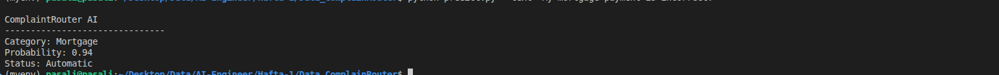
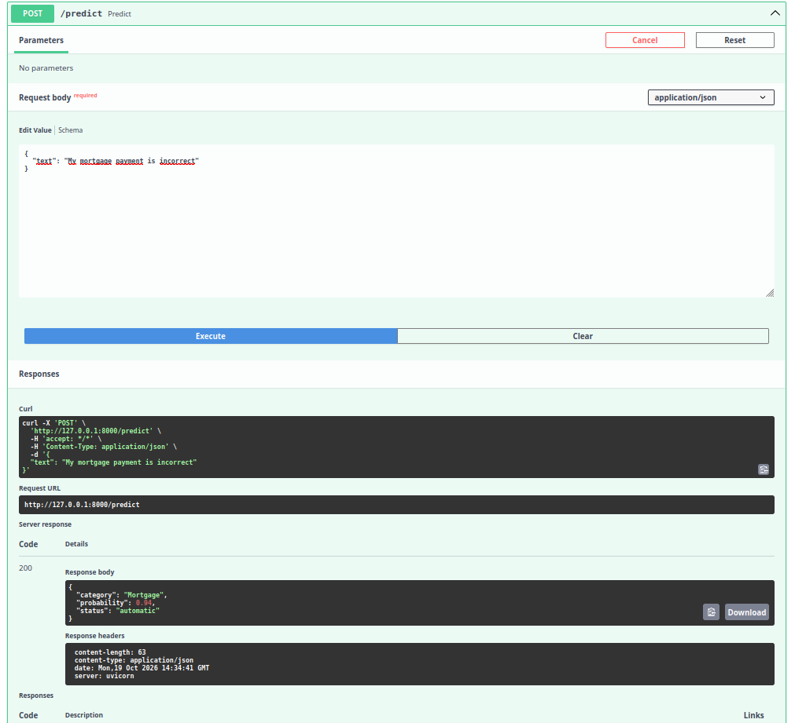
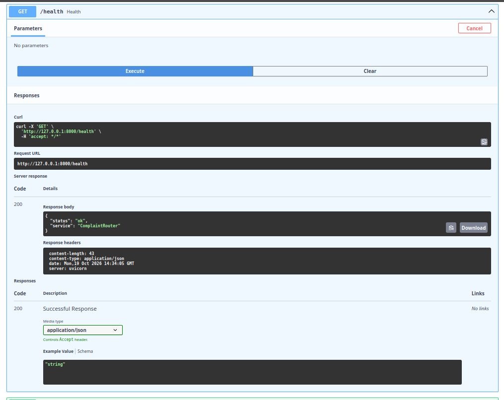
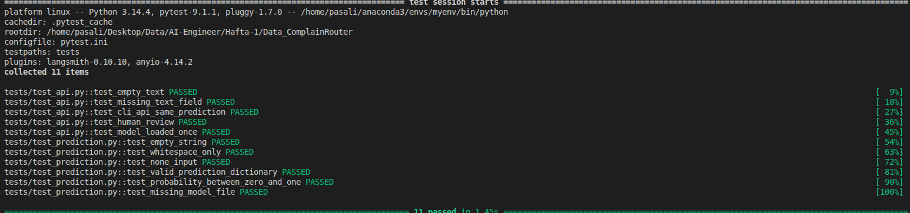
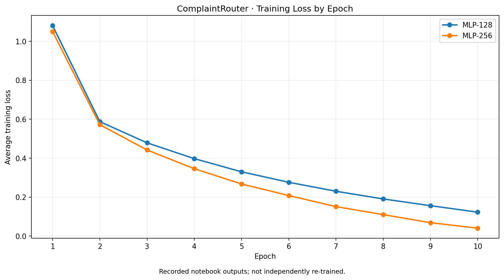
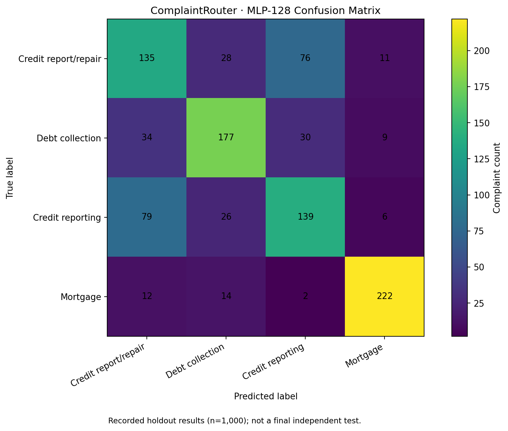

# ComplaintRouter AI

**Finansal müşteri şikâyetlerini sınıflandıran bir NLP projesi — model deneyinden çalışan CLI ve FastAPI servisine.**

`Python` · `Scikit-learn` · `TF-IDF` · `PyTorch` · `FastAPI` · `Pytest`

Bu projeye basit bir soruyla başladım: *Bir müşteri şikâyeti geldiğinde, onu ilgili finansal ürün kategorisine otomatik olarak yönlendirebilir miyim?* İlk adımda farklı sınıflandırma modellerini karşılaştırdım. Ardından seçtiğim modeli kaydedip terminalden ve bir REST API üzerinden kullanılabilir hâle getirdim.

Projenin benim için en öğretici tarafı, daha büyük bir sinir ağının mutlaka daha iyi sonuç vermediğini görmek oldu. Denediğim PyTorch MLP modelleri, bu veri ve değerlendirme koşullarında Logistic Regression baseline'ını geçemedi. Bu yüzden uygulamanın ilk sürümünde **TF-IDF + Logistic Regression** kullanıyorum.

**Şu anki durum:** Yerelde çalışan CLI ve FastAPI prototipi; paylaştığım son test çalıştırmasında **11/11 pytest testi başarılı**. Bu, sistemin üretime hazır olduğu anlamına gelmiyor. Bağımsız nihai test, olasılık kalibrasyonu ve daha kapsamlı veri kontrolleri hâlâ geliştirilmesi gereken alanlar.

[Sonuçlar](#model-deneyleri-ve-sonuçlar) · [Uygulama demosu](#uygulama-nasıl-çalışıyor) · [API](#fastapi-ile-http-servisi) · [Testler](#otomatik-testler) · [Kurulum](#kurulum-ve-çalıştırma) · [Sınırlamalar](#sınırlamalar-ve-sonraki-adımlar)

---

## Uygulama nasıl çalışıyor?

Uygulamaya İngilizce bir şikâyet metni verildiğinde model dört finansal kategoriden birini seçiyor, o sınıfa ait tahmin olasılığını döndürüyor ve sonuca göre otomatik yönlendirme veya insan incelemesi öneriyor.

```text
Şikâyet metni
     │
     ▼
Girdi kontrolü
     │
     ▼
Metin temizleme (FunctionTransformer)
     │
     ▼
TF-IDF (3.000 özellik)
     │
     ▼
Logistic Regression
     │
     ├── Tahmin edilen kategori
     ├── Sınıf olasılığı
     └── Yönlendirme kararı
             ├── ≥ 0.60 → automatic
             └── < 0.60 → human_review
```

Aynı tahmin mantığını hem komut satırı uygulaması hem de API kullanıyor. Böylece modeli farklı arayüzlerde yeniden yazmam gerekmiyor.

### Terminalden örnek tahmin

```bash
python predict.py --text "My mortgage payment is incorrect"
```

Yerel çalıştırmadan alınan sonuç:

```text
ComplaintRouter AI
-------------------------------
Category: Mortgage
Probability: 0.94
Status: Automatic
```



> Bu bir örnek tahmin çıktısıdır; modelin genel doğruluğunu tek başına göstermez.

---

## FastAPI ile HTTP servisi

Modeli yalnızca terminalden kullanmakla kalmak istemedim. Bir CRM veya müşteri destek uygulamasının da çağırabilmesi için basit bir **REST API** ekledim.

| Yöntem | Endpoint | İşlev |
|---|---|---|
| `GET` | `/health` | Servisin çalıştığını kontrol eder. |
| `POST` | `/predict` | Şikâyet metni için kategori, olasılık ve yönlendirme durumunu döndürür. |

### `POST /predict`

İstek:

```http
POST /predict
Content-Type: application/json
```

```json
{
  "text": "My mortgage payment is incorrect"
}
```

Yerel testte alınan yanıt (**HTTP 200**):

```json
{
  "category": "Mortgage",
  "probability": 0.94,
  "status": "automatic"
}
```



### `GET /health`

Servisin ayakta olduğunu kontrol etmek için ayrı bir endpoint oluşturdum. Yerel testte **HTTP 200** döndürüyor:

```json
{
  "status": "ok",
  "service": "ComplaintRouter"
}
```

<details>
<summary><strong>GET /health ekran görüntüsü</strong></summary>



</details>

API'yi başlattıktan sonra Swagger arayüzüne `http://127.0.0.1:8000/docs` adresinden ulaşılabiliyor. Buradaki ekran görüntüleri yerel geliştirme ortamından alındı; internete açık bir sunucuya dağıtım yapılmış değil.

### İnsan incelemesine yönlendirme

Her tahmini otomatik işlemek doğru olmayabilir. Bu nedenle ilk prototipte basit bir eşik kullandım:

- **En yüksek sınıf olasılığı ≥ 0,60:** `automatic`
- **En yüksek sınıf olasılığı < 0,60:** `human_review`

Bu **0,60 değeri deneysel bir iş kuralı**; kalibre edilmiş bir güven eşiği değil. `predict_proba()` çıktısındaki %94, gerçek dünyada tahminlerin tam olarak %94'ünün doğru olduğu anlamına gelmez. Ayrıca alan dışı şikâyetlerin her zaman düşük olasılıkla tespit edileceğinin garantisi yok.

---

## Otomatik testler

API'yi çalıştırdıktan sonra farklı girdilerde nasıl davranacağını kontrol etmek için `pytest` testleri hazırladım. Paylaştığım son yerel çalıştırmada **11 testin tamamı geçti**.

```bash
pytest -v
```



Testler iki parçaya ayrılıyor:

| Dosya | Kontrol edilen davranışlar |
|---|---|
| `tests/test_prediction.py` | Boş metin, yalnızca boşluk, `None`, geçerli tahmin sözlüğü, olasılık aralığı, model dosyasının eksik olması |
| `tests/test_api.py` | Boş/eksik metin, CLI–API tahmin tutarlılığı, insan incelemesi kararı, modelin tekrar tekrar yüklenmemesi |

Bu testlerin geçmesi önemli bir adım; ancak **11 başarılı uygulama testi, modelin %100 doğru olduğu anlamına gelmiyor**. Model performansını ayrı bir değerlendirme kümesinde ölçüyorum.

---

## Model deneyleri ve sonuçlar

Projede önce klasik makine öğrenmesi baseline'ı oluşturdum. Sonra aynı problem için PyTorch ile iki farklı MLP eğittim.

| Model | TF-IDF özellik sayısı | Accuracy | Macro-F1 |
|---|---:|---:|---:|
| **Logistic Regression** | **3.000** | **%72,60** | **0,7231** |
| Logistic Regression | 1.500 | %72,30 | 0,7197 |
| PyTorch MLP — 128 | 1.500 | %67,30 | 0,6739 |
| PyTorch MLP — 256 | 1.500 | Ölçülmedi | 0,6730 |

Bu değerler **4.000 eğitim / 1.000 holdout** ayrımına dayanan kayıtlı deney sonuçlarıdır. Holdout verisi model karşılaştırmasında da kullanıldığı için sonuçları bağımsız, nihai test performansı olarak sunmuyorum. Ayrıca 3.000 özellikli Logistic Regression ile 1.500 özellikli MLP karşılaştırmasında yalnızca algoritma değil, özellik sayısı da farklı.

### Neden Logistic Regression'ı seçtim?

Daha karmaşık ağın daha iyi çalışacağını varsaymıştım. Ancak 256 nöronlu model, eğitim kaybını **0,0406** seviyesine indirirken holdout Macro-F1 değeri **0,6730** oldu. 128 nöronlu modelde ise Macro-F1 **0,6739**.

Yani daha düşük training loss, görmediği verilerde daha iyi sonuç getirmedi. Mevcut ölçümlerde Logistic Regression hem daha güçlü bir referans model hem de uygulama tarafında daha sade bir seçenek oldu.



### PyTorch tarafında ne denedim?

İki ağın da girişi 1.500 boyutlu TF-IDF vektörü. Gizli katman boyutlarını değiştirerek aynı sınıflandırma problemini çözdüm:

```text
MLP-128: 1500 → 128 → 32 → 4    (196.388 parametre)
MLP-256: 1500 → 256 → 32 → 4    (392.612 parametre)
```

- Gizli katmanlarda `ReLU` kullandım.
- Son katman dört sınıfa ait **logits** üretiyor.
- Eğitimde `CrossEntropyLoss` ve `Adam(lr=0.001)` kullandım.
- `batch_size=32` ile **10 epoch** eğittim.
- Eğitim döngüsünde `zero_grad → forward → loss → backward → step` akışını kurdum.

### Model en çok nerede yanılıyor?

MLP-128'in confusion matrix'inde en fazla karıştırılan iki sınıf:

- `0`: **Credit reporting, credit repair services, or other personal consumer reports**
- `2`: **Credit reporting**

Bu iki sınıf arasında toplam **155 yanlış tahmin** var (`0 → 2`: 76, `2 → 0`: 79). Modelin en başarılı olduğu sınıf ise **Mortgage** (`F1 ≈ 0,89`).



Kredi raporlama kategorilerinin adları ve şikâyet dili birbirine yakın. Bu örtüşmenin ne kadarının etiketlerden, ne kadarının modelin özellik temsilinden kaynaklandığını anlamak için yanlış sınıflandırılmış metinleri ayrıca incelemek gerekiyor.

---

## Veri seti

Çalışmanın kaynağı, **[Consumer Complaint Database](https://www.consumerfinance.gov/data-research/consumer-complaints/)** verisi. Modelleme deneylerinde dört kategoriye ayrılmış, dengeli **5.000 metinlik** bir eğitim örneklemi kullandım (`complaints_train_5000.csv`). Her sınıfta 1.250 örnek var.

| Etiket (PyTorch) | Kategori |
|---:|---|
| `0` | Credit reporting, credit repair services, or other personal consumer reports |
| `1` | Debt collection |
| `2` | Credit reporting |
| `3` | Mortgage |

Girdi olarak `Consumer complaint narrative`, hedef olarak `Product` kullanılıyor. `Complaint ID` modele özellik olarak verilmiyor.

**Veri sızıntısı konusunda dikkat ettiğim nokta:** TF-IDF sözlüğü yalnızca eğitim verisinden öğrenildi. Bununla birlikte, model seçimi için kullanılan holdout ile bağımsız final testin kesin biçimde ayrılması ve cross-validation'ın tüm preprocessing adımlarını kapsaması sonraki metodolojik iyileştirmeler arasında.

Ham şikâyet metinleri kişisel bilgi içerebilir. Veri dosyalarını repoya eklemeden önce paylaşım koşulları ve kişisel veri riskleri kontrol edilmeli.

---

## Kurulum ve çalıştırma

Aşağıdaki komutlar **projenin kök klasöründen** çalıştırılacak şekilde yazıldı.

### 1. Depoyu indir

```bash
git clone https://github.com/alpaypasali/Ai_Engineer_Part.git
cd Ai_Engineer_Part/Hafta-1/Data_ComplainRouter
```

### 2. Sanal ortam oluştur ve bağımlılıkları yükle

```bash
python -m venv .venv
source .venv/bin/activate  # Linux / macOS
pip install -r requirements.txt
```

Windows kullanıyorsan sanal ortamı `.venv\Scripts\activate` ile etkinleştirebilirsin. API testleri için `pytest` ve `httpx`; servis için `fastapi` ve `uvicorn` gereklidir. `requirements.txt` dosyanın bu bağımlılıkları içerdiğini doğrula.

> Paylaşılan test ekran görüntüsü **Python 3.14.4 / pytest 9.1.1** ortamından. Farklı Python ve scikit-learn sürümlerinde özellikle kaydedilmiş modelin uyumluluğu yeniden kontrol edilmeli.

### 3. Kaydedilmiş modeli hazırla

Uygulama şu dosyayı bekliyor:

```text
models/complaintrouter_lr.joblib
```

Bu dosya yerel ortamında bulunmalı. GitHub'a eklenmemişse `notebooks/04-final_model.ipynb` içindeki eğitim ve kaydetme adımlarını **kendi verinle** çalıştırarak oluşturman gerekir. Pipeline'ın özel temizleme fonksiyonları için `preprocessing.py` modülünün de erişilebilir olması gerekiyor.

Güvenmediğin kaynaklardan `.joblib` dosyaları yükleme: `joblib.load()` pickle tabanlı olduğu için zararlı kod çalıştırabilir.

### 4. Terminalden tahmin yap

```bash
python predict.py --text "I received a debt collection notice for a debt I already paid."
```

### 5. API'yi başlat

```bash
uvicorn api:app --reload
```

Tarayıcıdan **[http://127.0.0.1:8000/docs](http://127.0.0.1:8000/docs)** adresini açarak `/health` ve `/predict` endpoint'lerini deneyebilirsin.

Alternatif olarak terminalden API'ye istek gönder:

```bash
curl -X POST "http://127.0.0.1:8000/predict" \
  -H "Content-Type: application/json" \
  -d '{"text":"My mortgage payment is incorrect"}'
```

### 6. Testleri çalıştır

```bash
pytest -v
```

---

## Proje yapısı

Geliştirme sırasında kullandığım ve README'de referans verdiğim temel dosya düzeni:

```text
Data_ComplainRouter/
├── api.py                          # FastAPI: /health ve /predict
├── predict.py                      # CLI ve tahmin fonksiyonu
├── preprocessing.py                # Ortak metin temizleme
├── pytest.ini
├── requirements.txt
├── notebooks/
│   ├── 01_data_audit.ipynb
│   ├── 02_baseline_model.ipynb
│   ├── 03_pytorch_mlp.ipynb
│   └── 04-final_model.ipynb
├── tests/
│   ├── test_api.py
│   └── test_prediction.py
├── models/
│   └── complaintrouter_lr.joblib   # Yerelde oluşturulan model artefaktı
├── figures/
│   ├── cli_prediction.png
│   ├── fastapi_predict.png
│   ├── fastapi_health.png
│   ├── pytest_11_passed.png
│   ├── training_loss_comparison.png
│   └── confusion_matrix_mlp128.png
└── README.md
```

Veri dosyaları yerelde `data/` altında tutulabilir; **repoya yüklenmiş oldukları varsayılmamalıdır**. Model artefaktı ve notebook'ların yeniden çalıştırılması için gereken CSV dosyaları ayrıca sağlanmalıdır.

---

## Sınırlamalar ve sonraki adımlar

Bu proje çalışan bir **yerel prototip**. Gerçek bir finansal kuruluşta kullanılmadan önce çözmem gereken konular var:

1. **Değerlendirme protokolü:** Train / validation / test ayrımını netleştirmek; hiperparametre aramasında preprocessing'i CV Pipeline içine almak ve hiç kullanılmamış test verisinde son ölçümü yapmak.
2. **Olasılıkların güvenilirliği:** Calibration incelemesi yapmak ve `%60` insan incelemesi eşiğini veriyle belirlemek.
3. **Belirsiz kategoriler:** Özellikle kredi raporlama sınıflarındaki `0 ↔ 2` hatalarını örnek bazında incelemek.
4. **Alan dışı girdiler:** Modelin tanımadığı konuları da mevcut dört sınıftan birine atadığını hesaba katarak OOD kontrolleri geliştirmek.
5. **Servis dayanıklılığı:** API için daha kapsamlı hata yönetimi, giriş uzunluğu sınırları, günlükleme ve güvenlik kontrolleri eklemek.
6. **Tekrarlanabilirlik:** Bağımlılık/model sürümlerini sabitlemek, eğitim süreçlerini yeniden çalıştırılabilir hâle getirmek ve CI üzerinde testleri otomatikleştirmek.

Bu çalışmada amacım sadece bir modele `fit()` çağırmak değildi. **Veriyi hazırlamaktan yanlış tahmini anlamaya, modeli kaydetmekten onu bir HTTP endpoint'i ile sunmaya kadar bütün akışı deneyimlemekti.** Şimdi en önemli sonraki adım, aynı akışı daha güvenilir değerlendirme ve test standartlarıyla güçlendirmek.

---

**Geliştiren:** [Alpay Paşalı](https://github.com/alpaypasali) · **Çalışma:** AI Engineer öğrenme yolculuğu / 1. hafta
