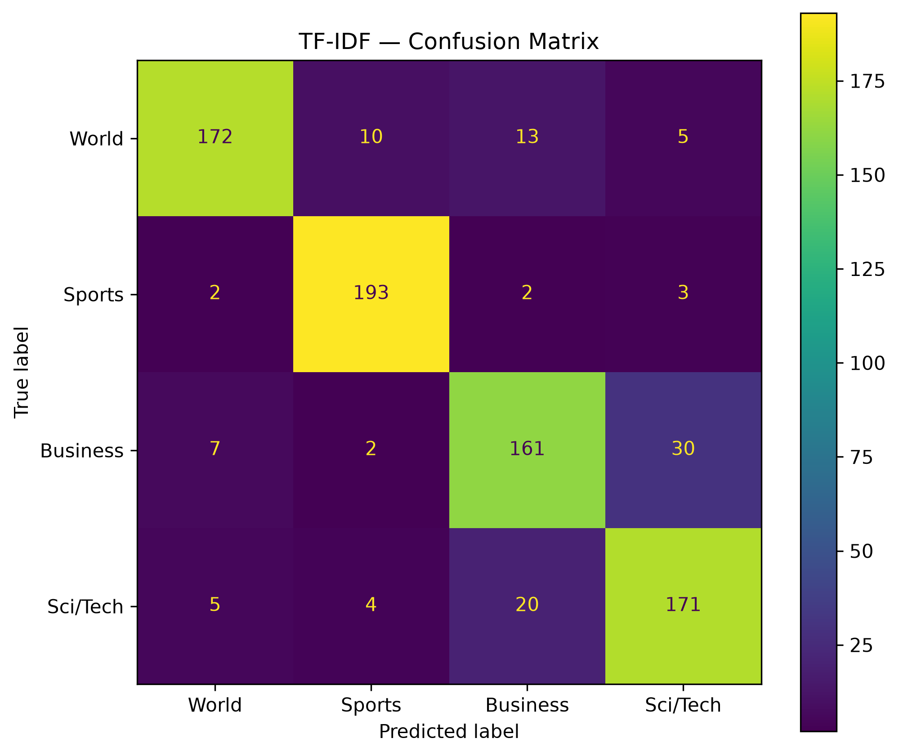
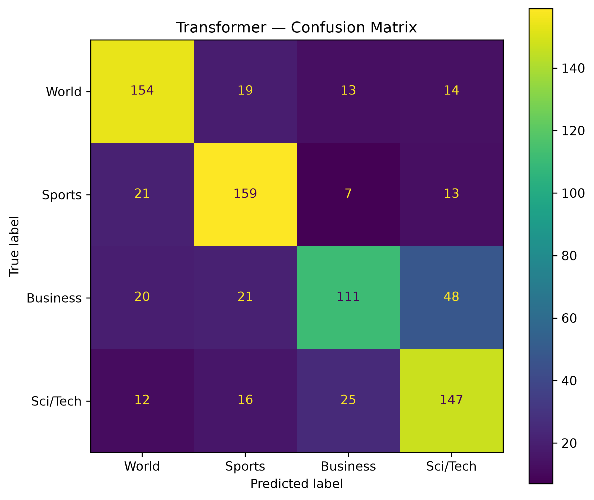

# NewsRoute — Gün 5: Model Karşılaştırması ve Hata Analizi

> **Çalışma:** Cuma günü değerlendirmesi · **Veri:** AG News · **Ana metrik:** Macro-F1  
> **Kapsam:** Aynı validation ayrımı üzerinde TF-IDF + Logistic Regression ve sıfırdan eğitilmiş Mini Transformer karşılaştırması. Orijinal AG News test kümesi kullanılmadı.

## Problem

NewsRoute, haberleri dört konu ekibinden birine otomatik yönlendirmek için geliştirilen bir haber sınıflandırma çalışmasıdır:

| Etiket | Kategori |
|---:|---|
| 0 | World |
| 1 | Sports |
| 2 | Business |
| 3 | Sci/Tech |

Yanlış sınıflandırma, haberin yanlış ekibe ulaşmasına, yeniden yönlendirme gerektirmesine ve süreçte gecikmeye neden olabilir. Bu nedenle toplam doğruluk kadar **sınıflar arasında dengeli başarı** ve hata türleri de önemlidir.

## Models

**Model A — TF-IDF + Logistic Regression (baseline)**

- `TfidfVectorizer(max_features=5000, ngram_range=(1, 2), lowercase=True)`
- `LogisticRegression(max_iter=1000)`
- Pazartesi günkü kurulumla, aynı `train_split.csv` üzerinde yeniden oluşturuldu. Yeniden hesaplanan validation değerleri eski baseline sonuçlarıyla eşleşti.

**Model B — NewsRouteTransformer (Mini Transformer)**

- Tokenizer: `text.lower().split()`; yalnızca training metinlerinden oluşturulan **7.787** token'lık vocabulary; `[PAD]=0`, `[UNK]=1`.
- `MAX_LENGTH=64`; token embedding (`d_model=64`) + sinusoidal positional encoding + tek Transformer Encoder katmanı (`num_heads=4`, `dim_feedforward=128`, `dropout=0.1`) + masked mean pooling + dört sınıflı linear head.
- Önceden eğitilmiş dil modeli kullanılmadı; model sıfırdan **3 epoch**, `AdamW(lr=0.001)` ve `CrossEntropyLoss` ile eğitildi.
- Perşembe günü kaydedilen `models/newsroute_transformer.pt` ağırlıkları yüklendi. Aynı token–ID eşleşmelerini koruyan `models/vocab.json` training verisinden yeniden oluşturuldu. **Cuma günü Transformer yeniden eğitilmedi.**

## Validation Data

- Train: **3.200** haber; validation: **800** haber (**her sınıfta 200**).
- İki model aynı `data/val_split.csv` dosyasındaki **aynı satırları ve aynı sırayı** kullandı.
- TF-IDF tahminleri doğrudan `val_df["text"]` üzerinden; Transformer tahminleri aynı sıra korunarak kodlanan `(800, 64)` token-ID Tensor'ı üzerinden üretildi.
- `y_true`, `tfidf_predictions`, `transformer_predictions` uzunlukları **800**. İlk validation haberinin Transformer için token-ID dönüşümü ayrıca doğrulandı.
- **Orijinal AG News test kümesine dokunulmadı.**

## Evaluation Metrics

- **Accuracy:** Doğru sınıflandırılan haberlerin toplam payı.
- **Macro Precision:** Dört sınıfın precision değerlerinin eşit ağırlıklı ortalaması.
- **Macro Recall:** Dört sınıfın recall değerlerinin eşit ağırlıklı ortalaması.
- **Macro-F1 (ana metrik):** Dört sınıfın ayrı F1 değerlerinin eşit ağırlıklı ortalaması; sınıflar arasındaki başarı farkını görünür kılar.
- **Sınıf bazlı Recall:** Gerçekten ilgili sınıfa ait haberlerin ne kadarının doğru yakalandığı.
- **Confusion Matrix:** Gerçek kategoriden hangi kategoriye kaç haber yönlendirildiği. Satırlar gerçek, sütunlar tahmin edilen sınıftır.

Bu metrikler **cuma günü üretilen validation tahminlerinden yeniden hesaplandı**; eski CSV'lerden kopyalanmadı.

## Model Comparison

| Metrik | TF-IDF + LR | Mini Transformer |
|---|---:|---:|
| Validation örnek sayısı | 800 | 800 |
| **Accuracy** | **0.8712** | 0.7138 |
| **Macro Precision** | **0.8719** | 0.7143 |
| **Macro Recall** | **0.8712** | 0.7138 |
| **Macro-F1** | **0.8711** | **0.7108** |
| World Recall | 0.8600 | 0.7700 |
| Sports Recall | 0.9650 | 0.7950 |
| Business Recall | 0.8050 | 0.5550 |
| Sci/Tech Recall | 0.8550 | 0.7350 |
| Doğru sınıflandırılan haber | **697 / 800** | **571 / 800** |

**Sonuç:** TF-IDF'nin Macro-F1 değeri **0.1603 puan** daha yüksek (`0.8711 − 0.7108`). Mevcut validation kümesinde dört sınıfın tamamında TF-IDF recall değeri daha yüksek. **0.7138**, Transformer'ın 571/800 doğru tahmininin dört ondalığa yuvarlanmış hâlidir.

Önerilen CSV: [`friday_model_comparison.csv`](./friday_model_comparison.csv).

## TF-IDF Confusion Matrix

*Satırlar gerçek sınıf, sütunlar tahmin edilen sınıf; sıra: World, Sports, Business, Sci/Tech.*

| Gerçek \ Tahmin | World | Sports | Business | Sci/Tech | Recall |
|---|---:|---:|---:|---:|---:|
| **World** | **172** | 10 | 13 | 5 | 86.0% |
| **Sports** | 2 | **193** | 2 | 3 | 96.5% |
| **Business** | 7 | 2 | **161** | 30 | 80.5% |
| **Sci/Tech** | 5 | 4 | 20 | **171** | 85.5% |

- En yüksek recall: **Sports, %96.5** (193/200).
- En düşük recall: **Business, %80.5** (161/200).
- En belirgin iki yönlü karışıklık: **Business → Sci/Tech (30)** ve **Sci/Tech → Business (20)**.

## Transformer Confusion Matrix

*Satırlar gerçek sınıf, sütunlar tahmin edilen sınıf; sıra: World, Sports, Business, Sci/Tech.*

| Gerçek \ Tahmin | World | Sports | Business | Sci/Tech | Recall |
|---|---:|---:|---:|---:|---:|
| **World** | **154** | 19 | 13 | 14 | 77.0% |
| **Sports** | 21 | **159** | 7 | 13 | 79.5% |
| **Business** | 20 | 21 | **111** | **48** | **55.5%** |
| **Sci/Tech** | 12 | 16 | 25 | **147** | 73.5% |

- En yüksek recall: **Sports, %79.5**; en düşük: **Business, %55.5**.
- En büyük tek yönlü karışıklık **Business → Sci/Tech: 48 haber** (200 Business haberinin %24'ü).
- Diğer önemli hatalar: **Sci/Tech → Business: 25**, **Sports → World: 21**, **Business → Sports: 21**, **Business → World: 20**.
- Business kategorisindeki 89/200 haber yanlış yönlendirildi. Bu, iş probleminde özellikle risklidir.

## Error Analysis — 10 Yanlış Haber

Transformer'ın yanlış sınıflandırdığı, farklı gerçek sınıflardan seçilmiş **10 farklı validation satırı** incelendi. Aşağıdaki yorumlar **metin içeriğinden türetilmiş olası açıklamalardır**; modelin attention ağırlıkları veya belirli sözcükler nedeniyle kesin olarak hata yaptığı ileri sürülmez.

| `row_id` | Gerçek | TF-IDF | Transformer | Metindeki ipuçları ve ihtiyatlı yorum |
|---:|---|---|---|---|
| **67** | Business | Business ✅ | World ❌ | Santander–Abbey satın alma teklifi, `EU` ve `single market` ile birlikte geçiyor. Ekonomik konunun uluslararası kurumlarla birlikte anılması karışıklığa katkıda bulunmuş olabilir. |
| **124** | World | World ✅ | Sports ❌ | `hurricane Ivan`, `dead`, `Caribbean`: doğal afet haberi. Sports tahminini açıklayan belirgin spor bağlamı yok. |
| **132** | Business | Business ✅ | World ❌ | `HealthSouth executive`, `court`, `appeal`: şirket yöneticisiyle ilgili hukuki gelişme, genel dünya haberi bağlamıyla karışmış olabilir. |
| **227** | Sports | Sports ✅ | Sci/Tech ❌ | Formula 1 pilotu Olivier Panis'in emekliliği; `Toyota` ve `test driver` terimleri teknik çağrışım yapabilir, ancak asıl konu spor kariyeri. |
| **554** | Business | Business ✅ | Sports ❌ | `oil price`, `Nigeria`, `rebel threat`: petrol fiyatları ve jeopolitik risk. `raced`, `record` gibi sözcüklerin olası etkisi kanıtlanmış değil. |
| **626** | World | World ✅ | Sci/Tech ❌ | `CBS`, `President Bush`, `National Guard`, `document`: siyasi/medyatik haber; Sci/Tech seçimini açıklayan güçlü teknik bağlam yok. |
| **628** | Sci/Tech | Sci/Tech ✅ | Sports ❌ | `HP`, `Unix`, `Opteron`, `Sun`: belirgin teknoloji terimleri. Kısa metin sınırlı bağlam sunuyor olabilir; kesin hata nedeni bilinmiyor. |
| **648** | Sci/Tech | Sci/Tech ✅ | Sports ❌ | `Sony Walkman`, `iPod`, `battery life`, `memory`: teknoloji ürünü karşılaştırması. Sports tahmini metnin ana konusuyla uyuşmuyor. |
| **757** | Sci/Tech | Sci/Tech ✅ | Sports ❌ | `NASA`, `Mach`, `hypersonic jet`, `speed record`: hız rekoru ifadesi sporla da ilişkilendirilebilir, fakat bağlam bilimsel/teknik uçuş. |
| **771** | Sports | Sports ✅ | Business ❌ | `skater`, `world champion`, `fall`, `program`: sporcunun performansına ilişkin haber. Business tahminini destekleyen açık ekonomik bağlam yok. |

**Bu seçilmiş 10 örneğin 10'unu da TF-IDF doğru sınıflandırdı.** Bu oran, tüm validation kümesindeki genel başarı oranı değildir: örneklem özellikle Transformer'ın yanlışlarından seçilmiştir. Seçim ayrıca sınıf çeşitliliği gözetilerek yapılmıştır; hata türü dağılımı tüm validation hatalarının temsili sayılmamalıdır.

Tam metinler ve sayısal etiketler: [`ten_wrong_predictions.csv`](./ten_wrong_predictions.csv). `row_id`, `val_split.csv` içindeki sıfır tabanlı satır konumudur.

## Findings

1. **Basit baseline mevcut deneyde daha başarılı.** TF-IDF, Macro-F1 ve sınıf bazlı recall metriklerinin tamamında önde.
2. **İki model de Business sınıfında zorlanıyor**, ancak Mini Transformer'da sorun daha belirgin: **%55.5 recall**, 48 Business haberini Sci/Tech olarak yönlendirme.
3. **Bazı hatalar kategori örtüşmesiyle uyumlu olabilir** (ör. uluslararası şirket gelişmeleri veya teknoloji ürünleri); bazı hatalarda ise metinden açık neden çıkarılamıyor.
4. **Daha karmaşık mimari otomatik üstünlük sağlamıyor.** TF-IDF kelime/bigram ipuçlarını az sayıda örnekle etkili kullanabilirken Mini Transformer bağlamsal temsilleri sıfırdan öğrenmek zorundaydı.
5. **Olası performans nedenleri ayrı ayrı kanıtlanmadı:** pretraining olmaması, 3.200 örnek, üç epoch ve model kapasitesi hakkında nedensel çıkarım yapabilmek için kontrollü deneyler gerekirdi. Bu görevde böyle bir deney yapılmadı.

## Model Decision

**Mevcut validation sonuçlarıyla NewsRoute için tercih: TF-IDF + Logistic Regression.**

- Ana metrikte **0.8711 vs 0.7108** Macro-F1 avantajı var.
- Dört sınıfın tamamında daha yüksek recall sunuyor; Business için fark özellikle kritik (**%80.5 vs %55.5**).
- TF-IDF'nin daha basit mimarisi geliştirme, bakım ve yorumlama açısından avantaj sağlayabilir; ancak gerçek gecikme/bellek maliyeti bu görevde ayrıca ölçülmedi.
- Yanlış yönlendirmelerin iş maliyetleri sınıfa ve haberin önemine göre değişebilir. Bu maliyetler henüz ölçülmediğinden, kritik veya belirsiz yönlendirmelerde insan kontrolü gerekebilir.

**Bu seçim, üretim sistemine alma onayı değildir; mevcut validation temelli bir aday model tercihidir.**

## Limitations

- **Veri kapsamı:** 3.200 train ve 800 validation haberi yalnızca bu deneyin sınırlı örneklemini temsil eder. Her sınıfta 200 validation örneği olsa da platformdaki gerçek sınıf dağılımı farklı olabilir.
- **Güncellik / distribution shift:** AG News örneklerinin dil, konu ve tarih dağılımı, yeni haberlere veya başka yayın organlarına doğrudan genellenemez. Güncel haberler üzerinde ayrıca değerlendirme gerekir.
- **Bağımsız test yok:** Orijinal AG News test kümesi henüz kullanılmadı. Validation sonuçlarıyla aday seçildiği için final performans bağımsız testte doğrulanmalı.
- **Yanlış yönlendirmenin etkisi ölçülmedi:** Haber önem derecesi, yanlış ekibe iletmenin maliyeti ve insan inceleme süreci test edilmedi. Özellikle Business → Sci/Tech karışıklığı dikkate alınmalı.
- **Model ve preprocessing sınırlamaları:** Mini Transformer sıfırdan, yalnızca 3 epoch eğitildi; kelimeler whitespace ile ayrıldı ve metinler 64 token'la sınırlandı. Bu ayarların etkileri ayrıca incelenmedi.
- **Hata analizi kapsamı:** 10 örnek, tüm yanlışların dağılımını temsil etmez. Kelimelere ilişkin çıkarımlar gözlemsel hipotezdir; attention veya açıklanabilirlik analizi yapılmadı.
- **Üretim koşulları değerlendirilmedi:** Gerçek zamanlı gecikme, ölçeklenebilirlik, izleme, yeniden eğitim, değişen sınıf dağılımı ve güvenlik/kalite kontrolleri doğrulanmadı.

**Beşinci sorunun cevabı:** Hayır; yalnızca mevcut validation bulgularıyla NewsRoute'un gerçek bir haber platformunda kullanılmaya hazır olduğunu söyleyemeyiz.

## Tests

Karşılaştırma notebook'unun sonunda aşağıdaki üç `assert` testi için kod hazırlandı:

| Test | Amaç | Bu rapor hazırlanırken durum |
|---|---|---|
| Test 1 — Validation Alignment | Her iki modelin 800 haberle ve aynı satır sırasıyla eşleşmesi | **Çalıştırma çıktısı henüz paylaşılmadı** |
| Test 2 — Confusion Matrix | Her iki matrisin `(4,4)` olması ve elemanlarının toplamının 800 olması | **Çalıştırma çıktısı henüz paylaşılmadı** |
| Test 3 — Wrong Predictions | 10 farklı `row_id` ve her satırda Transformer tahmininin hatalı olması | **Çalıştırma çıktısı henüz paylaşılmadı** |

> **Dürüst raporlama:** GÖREV 7'nin test kodu yazılmış olsa da üç `PASSED` satırının gerçek çalıştırma sonucu bu konuşmada görülmedi. Notebook'ta çalıştırılıp doğrulanınca tablo güncellenmelidir. Daha önce paylaşılan tahmin/Confusion Matrix çıktıları ve 10 yanlış haber tablosu ise ilgili sonuçları desteklemektedir.

## What I Learned — Öğrendiklerim

- **Aynı validation veri sırası**, iki farklı modelin adil karşılaştırılmasında zorunludur; özellikle Transformer'ın token ID'lerine dönüştürdüğüm metinlerin satır eşleşmesini korumalıyım.
- **Macro-F1**, yalnızca genel Accuracy'ye bakmaktan daha dengeli bir görüş sağlar; sınıf bazlı Recall ve Confusion Matrix ise hangi ekibin daha fazla yanlış yönlendirme aldığını gösterir.
- **Daha karmaşık model her zaman daha iyi değildir:** Basit kelime/bigram temsilleri, küçük ve etiketli veri üzerinde güçlü bir baseline oluşturabilir.
- **Yanlış tahmini görmek, hatanın nedenini kanıtlamak değildir.** Haber metninden hipotez kurabilirim ama modelin iç işleyişine dair desteklenmeyen kesin iddialarda bulunmamalıyım.
- **Model seçimi iş problemine bağlıdır:** Şu anda TF-IDF'yi tercih ederim; ancak bağımsız test, güncel veri ve operasyonel risk analizi yapılmadan gerçek platforma hazır olduğunu söylemem.

## Beş Sorunun Kısa Yanıtı

1. **Hangi modelin Macro-F1'i daha yüksek?** TF-IDF + Logistic Regression: **0.8711** (Mini Transformer: **0.7108**).
2. **Transformer en çok hangi sınıfları karıştırıyor?** En büyük hata **Business → Sci/Tech (48)**; **Sci/Tech → Business (25)** da belirgin. Business sınıfı genel olarak en düşük recall'a sahip (**%55.5**).
3. **10 yanlış haberin kaçını TF-IDF doğru bildi?** **10/10**; fakat bu, özellikle seçilmiş küçük bir örneklem.
4. **Karmaşık model neden daha düşük sonuç vermiş olabilir?** Pretraining yokluğu, sınırlı training verisi, üç epoch ve öğrenilecek temsillerin karmaşıklığı. Bunlar deneyimizde ayrı ayrı test edilmediği için **hipotez**.
5. **NewsRoute gerçek bir platforma hazır mı?** **Hayır, henüz değil.** Veri kapsamı sınırlı; güncel haberlere genelleme, bağımsız test başarısı ve yanlış yönlendirmelerin iş etkisi henüz doğrulanmadı.

---

### İlgili çıktılar

- `notebooks/06_model_comparison.ipynb` — aynı validation örnekleri, tahminler, metrikler, grafikler, test kodu.
- `reports/friday_model_comparison.csv` — iki modelin validation metrikleri (notebook'taki kodla oluşturulur).
- `reports/ten_wrong_predictions.csv` — 10 yanlış haber; özgün metinler korunur.
- `figures/tfidf_confusion_matrix.png` ve `figures/transformer_confusion_matrix.png` — dört sınıflı matrisler.
- `models/newsroute_transformer.pt` ve `models/vocab.json` — kayıtlı Transformer ağırlıkları ve eşleşen vocabulary.

**GitHub notu:** Bu Markdown dosyasının oluşturulması GitHub'a otomatik olarak gönderildiği anlamına gelmez; dosyayı NewsRoute projesinin `reports/` klasörüne ekleyip ilgili sonuçlarla birlikte commit/push yapmak gerekir.
