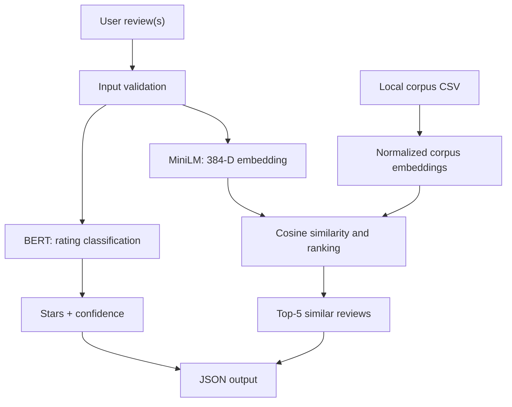
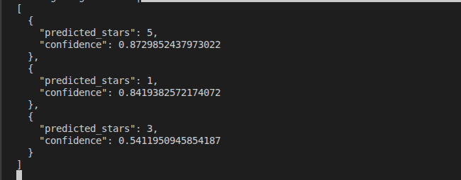
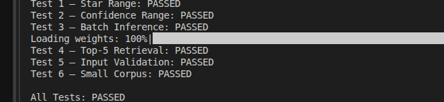

# ReviewLens — Review Rating & Semantic Search

ReviewLens is an educational NLP project that predicts customer review ratings from 1 to 5 stars and retrieves the five most semantically related reviews from a local corpus. It combines pretrained Hugging Face models with a reusable Python inference pipeline.

> Portfolio draft: The Yelp-derived experimental results below are for private educational review. Obtain any required Yelp approval before publishing them publicly. No raw Yelp reviews are included in this package.

## Dataset

[Yelp Review Full](https://huggingface.co/datasets/Yelp/yelp_review_full) contains English-language reviews with five rating classes. A balanced local sample of 1,000 reviews (200 per rating) was used:

| Experiment | Samples |
|---|---:|
| Retrieval corpus | 800 |
| Retrieval queries | 200 |
| Classification evaluation | 200 (40 per star) |

All samples came from the original training split. The classification results are development measurements, not independent final-test performance. The local CSV is not distributed.

## System architecture



- Classification: NLP Town multilingual BERT, batch size 8, maximum length 256, truncation enabled.
- Retrieval: all-MiniLM-L6-v2, L2-normalized 384-dimensional embeddings, dot product for cosine similarity, up to five results.
- Models are loaded lazily, with CPU or CUDA selected automatically. The corpus embeddings are reused within the same engine instance.
- Both models are pretrained. No additional fine-tuning was performed.
- Retrieval is optional; rating inference works without a corpus.

## Model comparison

Both candidates were evaluated on exactly the same 200 balanced reviews.

| Metric | NLP Town BERT (A) | TabularisAI DistilBERT (B) |
|---|---:|---:|
| Accuracy | **0.5550** | 0.4200 |
| Macro Precision | **0.5605** | 0.4319 |
| Macro Recall | **0.5550** | 0.4200 |
| Macro-F1 | **0.5532** | 0.3827 |
| 1-Star Recall | **0.6000** | 0.5000 |
| 1-Star Error Rate | **40%** | 50% |
| Model license | MIT | CC BY-NC 4.0 |
| Output | Direct star rating | Sentiment level mapped to stars |

**Selected model: A.** It achieved better results across the classification metrics, missed fewer genuinely 1-star reviews and directly predicts star ratings. The model license is also more flexible, subject to its conditions and separate data rights.

## Retrieval results

| Metric | TF-IDF | MiniLM embeddings |
|---|---:|---:|
| Corpus size | 800 | 800 |
| Query size | 200 | 200 |
| Top-1 Same-Star Rate | 0.335 | 0.305 |
| Top-5 Same-Star Fraction | 0.291 | 0.297 |

TF-IDF performed slightly better on Top-1 star agreement; MiniLM performed slightly better on Top-5 agreement. In the qualitative comparison, embeddings offered useful topic-based results even when words differed. Same-star agreement is only a proxy; it is **not** a semantic relevance accuracy metric. MiniLM was selected for semantic search, not because it won every proxy metric.

## Inference latency

Measured on the same 20 reviews (four per star) on `cuda:0`, with model warm-up, synchronized timing, batch size 1, and max length 256. Model loading and download times were excluded.

| Metric (ms) | Model A | Model B |
|---|---:|---:|
| Mean | 16.76 | **7.16** |
| Median | 11.38 | **5.34** |
| P95 | 32.26 | **14.61** |

Model B was faster, but Model A's classification quality was prioritized. These small-sample classifier measurements do not represent end-to-end retrieval latency or production service guarantees.

## Installation

Run from the ReviewLens directory with Python 3.12:

```bash
python -m venv .venv
source .venv/bin/activate
python -m pip install torch==2.8.0 --index-url https://download.pytorch.org/whl/cpu
python -m pip install -r requirements.txt
python -m pip check
```

These commands install the CPU version. For GPU inference, install the PyTorch build compatible with your hardware. Model files are downloaded on first use. The requirements cover the final pipeline and its tests.

## Usage

Single review:

```bash
python -m src.predict "The food was delicious."
```

Batch inference:

```bash
python -m src.predict "Amazing food." "Terrible service." "The food was average."
```

Rating prediction with semantic search:

```bash
python -m src.predict --corpus data/retrieval_corpus.csv "The food was delicious."
```

The optional corpus CSV must contain `text,stars` columns; `row_id` is optional and must contain unique integers if provided. Use reviews you are authorized to process. The private 800-review corpus from the retrieval notebook can be reused locally if permitted; it is not shipped in this repository.

Python API:

```python
from src.predict import ReviewLens

engine = ReviewLens()
print(engine.predict("Amazing food."))
print(engine.predict_batch(["Amazing food.", "Terrible service."]))
```

Each prediction includes `predicted_stars` and `confidence`. Optional retrieval adds `similar_reviews` with original corpus stars, review text, row ID and similarity. Results are ordered by descending similarity. Fewer than five corpus entries yield fewer results; an empty corpus is rejected.

### Working system

Actual terminal output from a batch with three synthetic reviews: 5, 1 and 3 stars.



## Tests

```bash
python -m unittest discover -s tests -v
python -m tests.smoke_test
python -m tests.error_scenarios
```

The first command runs ten offline unit tests. The remaining commands exercise both actual pretrained models using synthetic text and temporary corpora, without requiring Yelp data.

Final verification: all 10 unit tests, the real-model smoke test, the error-scenario checks and the dependency consistency check passed in the Python 3.12 CPU environment.



The original local run passed all six scenario checks. The packaged unit suite additionally checks label mapping, corpus validation and friendly CLI errors.

## Limitations

- Long reviews are truncated to 256 tokens; important content at the end may be lost.
- Sarcasm and mixed sentiment can produce incorrect or ambiguous ratings. High confidence does not guarantee a correct prediction.
- NLP Town BERT was trained on product reviews; domain-specific performance needs further validation.
- The selected classifier still misclassified 40% of actual 1-star reviews in this sample.
- Semantic retrieval can return comments with opposite sentiment. Similarity is not a rating prediction.
- Small development samples, no independent test set, and no calibrated confidence evaluation limit generalization.
- This is a learning project, not a production-ready rating system.

## Project files

| File | Purpose |
|---|---|
| `src/predict.py` | Final inference and retrieval pipeline |
| `tests/test_predict.py` | Offline automated unit tests |
| `tests/smoke_test.py` | Actual model integration test |
| `tests/error_scenarios.py` | Actual model scenario testing |
| `requirements.txt` | Tested pipeline dependency versions |
| [Data card](reports/data_card.md) | Dataset, evaluation protocol and data rights |
| [Model card](reports/model_card.md) | Model selection, performance and risks |
| [Final report](reports/day_07_final.md) | Final findings, fixes and test evidence |

## Data and model rights

The classifier model card lists MIT; the retrieval model card lists Apache-2.0. These model licenses do not grant rights to Yelp data. The [dataset card](https://huggingface.co/datasets/Yelp/yelp_review_full) links the Yelp dataset agreement. That agreement restricts redistribution and requires approval for public release of academic findings involving the data or brand. Do not publish raw reviews, row-level predictions, indices, embeddings, notebook outputs, or derived metrics until the relevant rights and approval are confirmed. This project is not affiliated with Yelp.

Use synthetic examples for public demonstrations.

## References

- [NLP Town BERT](https://huggingface.co/nlptown/bert-base-multilingual-uncased-sentiment)
- [TabularisAI sentiment model](https://huggingface.co/tabularisai/multilingual-sentiment-analysis)
- [all-MiniLM-L6-v2](https://huggingface.co/sentence-transformers/all-MiniLM-L6-v2)
- [Yelp Review Full](https://huggingface.co/datasets/Yelp/yelp_review_full)
