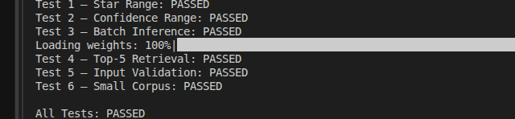

# Day 07 — ReviewLens Final Report

**Date:** 2026-11-15  
**Status:** Final educational prototype; not approved for production.

## 1. Objective

The goal was to build a reusable system for predicting 1–5 review stars and finding related reviews using semantic retrieval. The work covered tokenization, pretrained models, evaluation, model selection, inference and automated testing.

## 2. Dataset and experiments

The local Yelp Review Full sample included 1,000 reviews, 200 per rating. Retrieval used 800 corpus reviews and 200 queries. Classification used a fixed balanced evaluation set of 200 reviews with 40 examples per star. Both classifier candidates used the same evaluation order. The original Yelp test split was not used.

## 3. Classification and model selection

| Metric | NLP Town BERT | TabularisAI DistilBERT |
|---|---:|---:|
| Accuracy | 0.5550 | 0.4200 |
| Macro Precision | 0.5605 | 0.4319 |
| Macro Recall | 0.5550 | 0.4200 |
| Macro-F1 | 0.5532 | 0.3827 |
| 1-Star Recall | 0.6000 | 0.5000 |
| 1-Star Error Rate | 0.4000 | 0.5000 |
| License | MIT | CC BY-NC 4.0 |

The error rate is `1 - Recall_1Star`. The selected model missed 16 of 40 actual 1-star reviews, compared with 20 for the alternative. NLP Town BERT was selected for its stronger class-balanced results, lower critical-review error, direct rating labels and more flexible model licensing.

## 4. Retrieval comparison

| Metric | TF-IDF | MiniLM |
|---|---:|---:|
| Corpus | 800 | 800 |
| Query | 200 | 200 |
| Top-1 Same-Star Rate | 0.335 | 0.305 |
| Top-5 Same-Star Fraction | 0.291 | 0.297 |

TF-IDF uses sparse word-based representations. MiniLM represents texts as normalized 384-dimensional dense vectors. Both produce a similarity matrix of shape (200, 800). For normalized embeddings, the dot product equals cosine similarity.

The five-query qualitative review illustrated the different strengths of keyword overlap and semantic matching. The rating-based proxy is not ground-truth semantic relevance. MiniLM was chosen for the final semantic retrieval branch, while TF-IDF remains a useful baseline.

## 5. Latency

| Statistic (ms) | Model A | Model B |
|---|---:|---:|
| Mean | 16.76 | 7.16 |
| Median | 11.38 | 5.34 |
| P95 | 32.26 | 14.61 |

Measured on the same 20 reviews on CUDA, warmed up, synchronized, batch size 1, max length 256. Model B was approximately 2.34 times faster by mean latency. Model A's stronger predictive results outweighed the measured latency difference for this prototype. No production latency or throughput claim is made.

## 6. Final pipeline

`src/predict.py` provides input validation, single and batch rating inference, confidence scores, explicit star mapping, truncation, lazy model loading, corpus encoding and Top-5 similarity ranking. Classifier batch size is 8 and embedding batch size is 32. Model weights are not updated.

The Python API can reuse both models and corpus embeddings. CLI output is JSON. Retrieval is optional, and the downloaded pretrained models can be tested using synthetic reviews.

## 7. Error scenarios

The final scenario run used synthetic text.

| Scenario | Observed result |
|---|---|
| Empty / whitespace input | Rejected |
| Long review | 895 original tokens, 256 retained; 5 stars, confidence 0.7682 |
| Three-review batch | 5, 1, 3 stars, in original input order |
| Irony | 5 stars, confidence 0.8792; inconsistent with the intended complaint |
| Mixed sentiment | 3 stars, confidence 0.5088 |

Two implementation issues were addressed: the CLI now rejects whitespace before model loading without a traceback, and a corpus with fewer than five reviews now returns all available results instead of raising an error. Empty corpora remain invalid. These fixes do not resolve sarcasm or truncation limitations.

## 8. Automated tests

The user's terminal run reported all six scenario checks passed:

1. Star range
2. Confidence range
3. Batch inference
4. Top-5 retrieval
5. Input validation
6. Small corpus

The final package was independently verified in a Python 3.12 CPU environment: all ten offline unit tests, the real-model smoke test, the error-scenario checks and `pip check` passed. The smoke and error-scenario scripts run the actual models against synthetic text. See [scenario report](final_error_scenarios.md) and the evidence below.

Earlier notebook tests were supplied as part of the weekly exercises. The Friday report did not yet confirm their final PASS outputs; this report does not substitute final pipeline tests for those notebook checks.

## 9. Limitations

- Only 200 development examples were used for classification evaluation.
- Star agreement is an imperfect proxy for semantic relevance.
- Model confidence is not independently calibrated.
- Long text, irony and mixed sentiment remain challenging.
- The original tokenizers and model architectures differ.
- Inference latency depends on hardware and input lengths. End-to-end retrieval latency was not benchmarked.
- Model and data permissions must be considered independently.

## 10. What I learned

I learned how tokenization and truncation affect predictions, how TF-IDF differs from dense embeddings, and why normalized vectors make cosine similarity easy to calculate. I also learned to compare models using the same samples, Macro-F1, critical-class error and latency. The fastest model is not always the most appropriate. A successful software test proves certain pipeline behaviors, not that the model understands every review correctly.

## 11. Final conclusion

ReviewLens now has a reusable pretrained rating and retrieval pipeline, tested against both normal and edge-case inputs. Model A is the best candidate among the two compared in this development evaluation. More reliable real-world validation and appropriate data permissions are required before deployment.

This is a private educational report pending any required publication approval. No raw Yelp review text, evaluation indices or row-level derivatives are included in the final package. See [data card](data_card.md) and [model card](model_card.md).
