# FinanceSentinel

**Financial sentiment classification with DistilBERT — from fine-tuning to a tested inference pipeline.**

    

FinanceSentinel classifies short English financial news statements as **Negative**, **Neutral**, or **Positive**. I built it to understand the full lifecycle of a transformer-based NLP system: data preparation, fine-tuning, model selection, independent evaluation, calibration, robustness, and deployment-oriented inference.

The primary result was not simply a high score. The model achieved 93.81% Macro-F1 on the held-out test set, but only 30% accuracy on a targeted counterfactual challenge set. That gap is a reminder that strong benchmark performance does not guarantee sound financial interpretation.

## Results at a glance

| Metric | Result |
|---|---:|
| Test accuracy | **95.13%** (215/226) |
| Test Macro-F1 | **93.81%** |
| Negative recall | 93.55% |
| Test ECE | 0.020372 |
| Macro-F1 95% bootstrap interval | 89.79%–97.40% |
| Robustness accuracy | 30% (3/10) |
| Model parameters | 66,955,779 |
| Peak notebook inference throughput | 1,331.30 sentences/s |
| Peak fresh-process inference throughput | 868.91 sentences/s |
| Application tests (pytest) | 12/12 passed |

**Scope:** educational and non-commercial research. This is not a trading, investment recommendation, or price prediction system.

## 1. Dataset and preparation

The project uses [Financial PhraseBank](https://huggingface.co/datasets/takala/financial_phrasebank), a collection of English financial news sentences annotated with sentiment labels. I compared four agreement levels before selecting `sentences_allagree` (100% annotator agreement).

| Agreement | Sentences | Negative | Neutral | Positive |
|---|---:|---:|---:|---:|
| 50% | 4,846 | 604 | 2,879 | 1,363 |
| 66% | 4,217 | 514 | 2,535 | 1,168 |
| 75% | 3,453 | 420 | 2,146 | 887 |
| 100% | 2,264 | 303 | 1,391 | 570 |

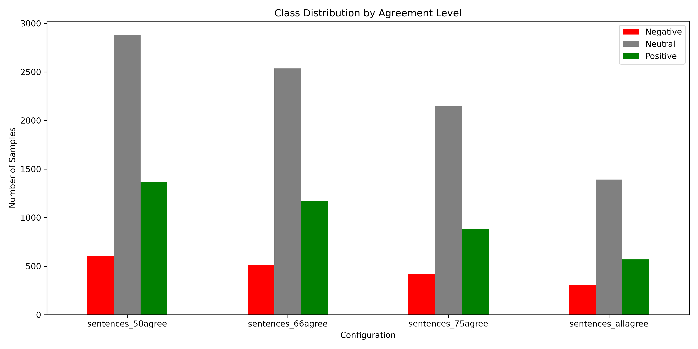

*Figure 1. Neutral is the majority class across all agreement levels. I chose Macro-F1 as the primary metric so that performance on minority classes would not be hidden by overall accuracy.*

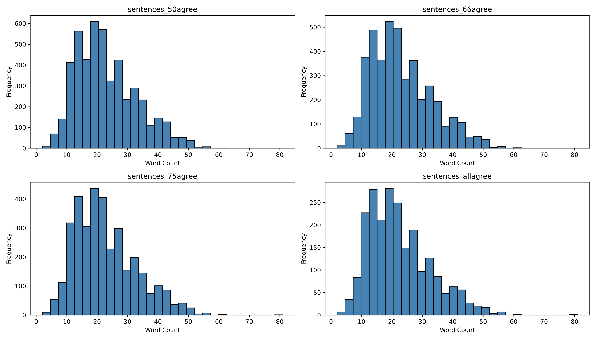

*Figure 2. Sentence lengths are right-skewed, with most examples containing roughly 10–30 words. Word counts are not equivalent to transformer token counts.*

I removed five exact duplicates before creating stratified splits with seed 42. The configurations overlap, so they were not combined or used as independent evaluation sets.

| Split | Negative | Neutral | Positive | Total |
|---|---:|---:|---:|---:|
| Train | 242 | 1,109 | 456 | 1,807 |
| Validation | 30 | 139 | 57 | 226 |
| Test | 31 | 138 | 57 | 226 |
| Total | 303 | 1,386 | 570 | 2,259 |

Labels: `0 = Negative`, `1 = Neutral`, `2 = Positive`. The held-out test split was preserved until after checkpoint selection. Exact sentence intersections between splits were checked; near-duplicate and article-level overlap have not been exhaustively ruled out.

See the [Data Card](reports/data_card.md) for the data quality, agreement analysis, provenance, and limitations.

## 2. System architecture

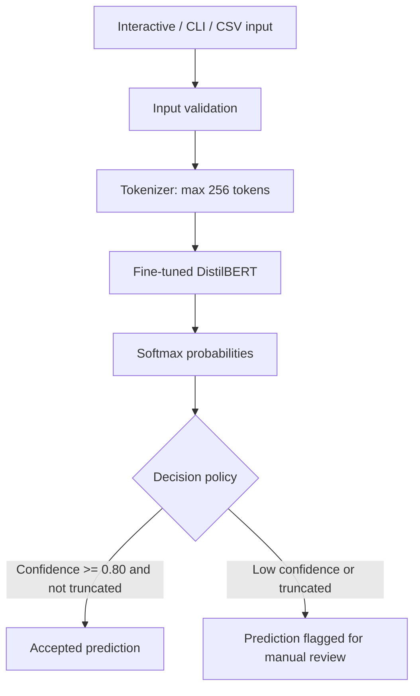

The inference class loads the model and tokenizer only once, selects CPU or CUDA, applies dynamic padding, and runs the model in evaluation and inference mode. The label mapping is read from the model configuration rather than hard-coded in the predictor. Batch results retain input order. The CLI returns JSON for a single sentence and writes structured CSV results for a batch.

The review policy is an additional guardrail, not a guarantee of semantic correctness. A flagged prediction remains visible with its confidence and review reasons; it is not silently relabeled.

## 3. Fine-tuning and model selection

I used the pretrained [`distilbert-base-uncased`](https://huggingface.co/distilbert/distilbert-base-uncased) encoder with a three-class sequence classification head and fine-tuned the complete model.

| Configuration | Value |
|---|---|
| Architecture | DistilBERT, 6 layers, hidden size 768, 12 attention heads |
| Parameters | 66,955,779 |
| Epochs | 3 |
| Learning rate | 2e-5 |
| Train / evaluation batch size | 16 / 16 |
| Weight decay | 0.01 |
| Warmup ratio | 0.1 |
| LR scheduler | Linear |
| Maximum input length | 256 tokens (including special tokens) |
| Model selection metric | Validation Macro-F1 |
| Seed / training steps | 42 / 339 |

### Training curves

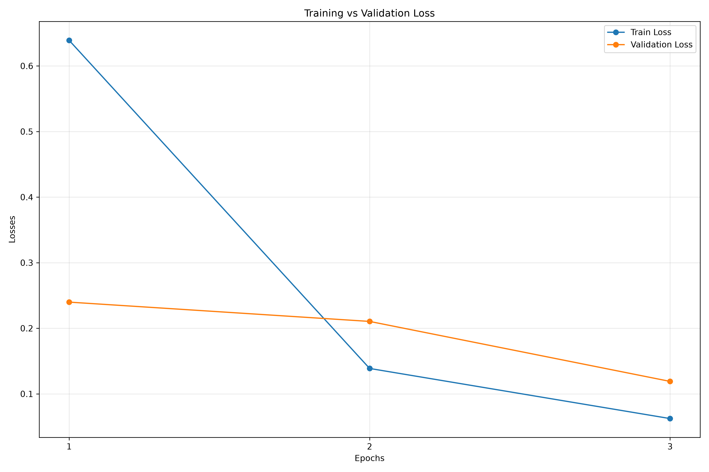

*Figure 3. Loss decreased over three epochs in the initial fine-tuning experiment, while validation loss also improved. These curves correspond to the initial experiment, not necessarily the final 256-token checkpoint.*

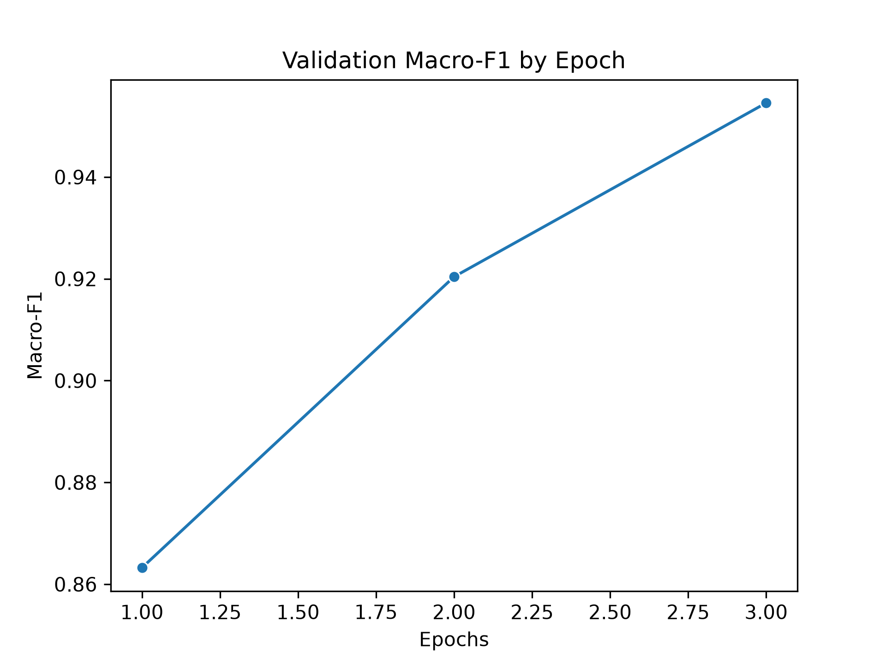

*Figure 4. Validation Macro-F1 improved from approximately 0.863 to 0.955 across the three initial training epochs.*

### Sequence length experiment

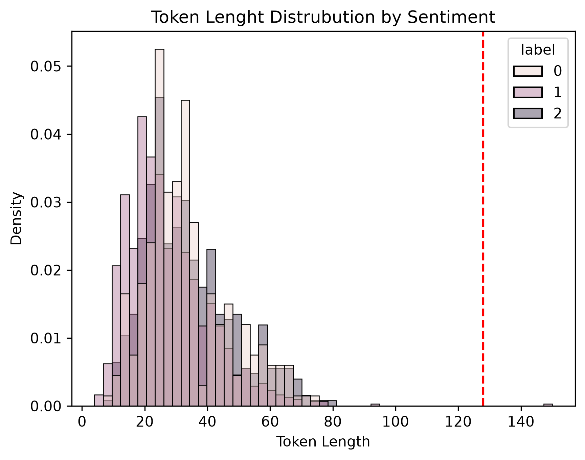

*Figure 5. Token lengths were measured separately from word lengths to assess truncation risk.*

| Max length | Val. accuracy | Val. Macro-F1 | Training time | Peak GPU memory |
|---:|---:|---:|---:|---:|
| 128 | 96.46% | 94.996% | 18.04 s | 1,514.97 MB |
| **256** | **96.90%** | **95.880%** | 18.09 s | 1,633.62 MB |

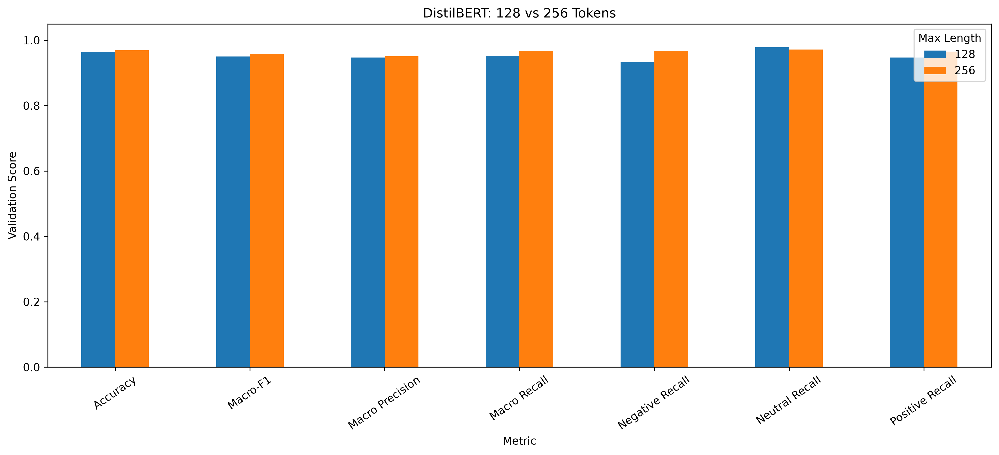

*Figure 6. The 256-token run achieved better validation Macro-F1 and was selected before the held-out test evaluation.*

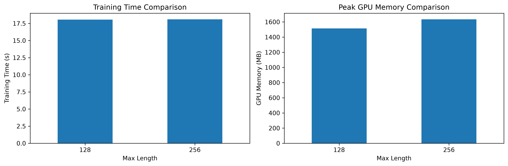

*Figure 7. Training time remained similar, while the longer configuration used around 119 MB more peak allocated GPU memory.*

The selected checkpoint is `models/length_resource_experiment_256/checkpoint-339`. It was exported with its tokenizer to `models/financesentinel_final/`, using FP32 Safetensors (approximately 268.55 MB for the export). Since the validation sentences were already shorter than 128 tokens, the improvement cannot be attributed directly to retaining more validation text. Repeated training seeds would be needed to establish the stability of this difference.

## 4. Evaluation

### Baseline and fine-tuned comparison

| Validation model | Accuracy | Macro-F1 |
|---|---:|---:|
| Majority-class baseline | 61.50% | 25.39% |
| Zero-shot baseline | 29.20% | 30.47% |
| Initial fine-tuned DistilBERT | 96.46% | 95.46% |
| Selected DistilBERT (256 tokens) | **96.90%** | **95.88%** |

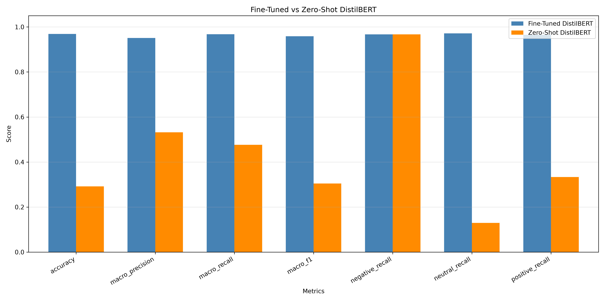

*Figure 8. Domain-specific supervised fine-tuning performed substantially better than the evaluated zero-shot configuration; this comparison is specific to these models and this validation split.*

<details>
<summary>Zero-shot confusion matrix</summary>

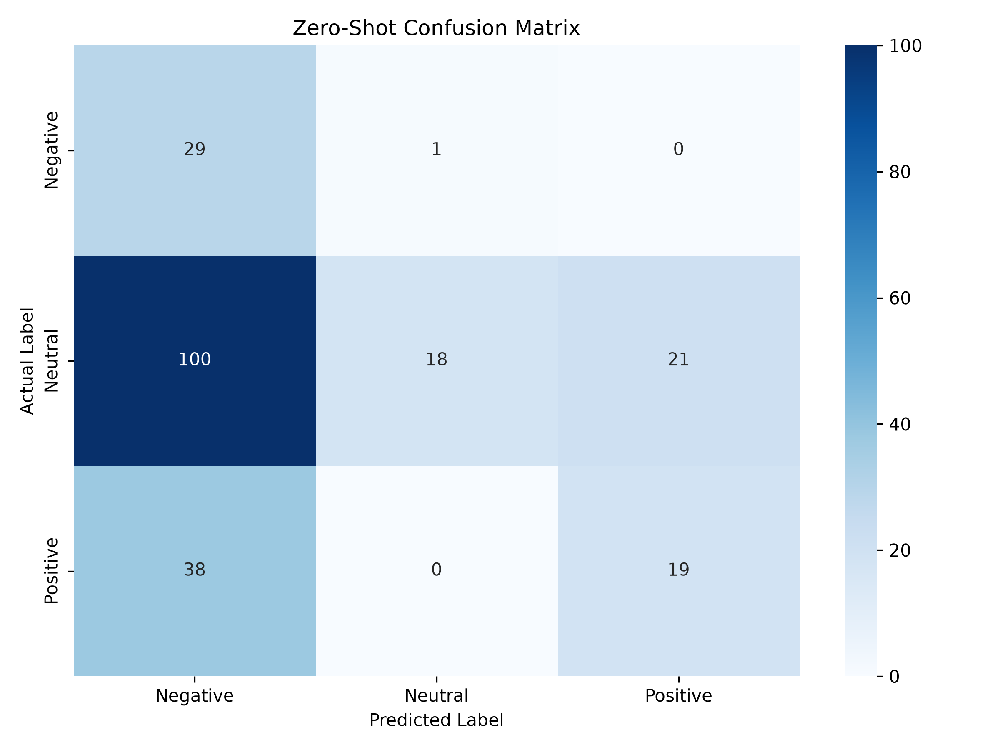

*Figure 9. The zero-shot model struggled to reproduce the three-class annotation scheme. This motivated using the domain-specific labeled training data.*

</details>

### Independent test results

| Metric | Validation | Test |
|---|---:|---:|
| Accuracy | 96.90% | 95.13% |
| Macro-F1 | 95.88% | **93.81%** |
| Macro precision | 95.07% | 93.04% |
| Macro recall | 96.76% | 94.65% |
| Negative recall | 96.67% | 93.55% |
| Neutral recall | 97.12% | 95.65% |
| Positive recall | 96.49% | 94.74% |
| ECE (5 bins) | 0.005165 | 0.020372 |

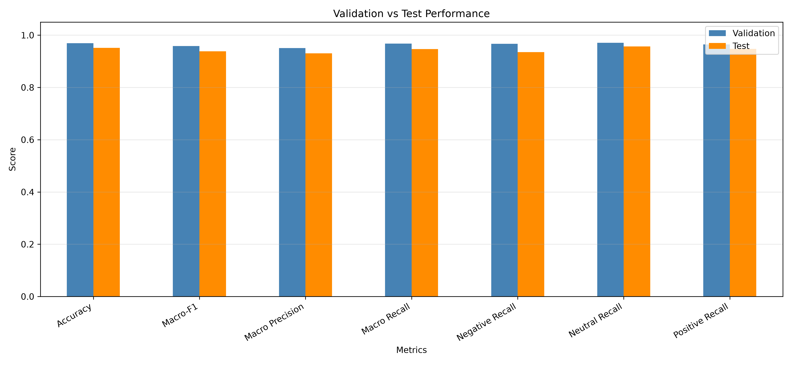

*Figure 10. Test Macro-F1 was 2.07 percentage points below validation. The test examples were unseen during model selection but still came from the same corpus.*

### Confusion matrix

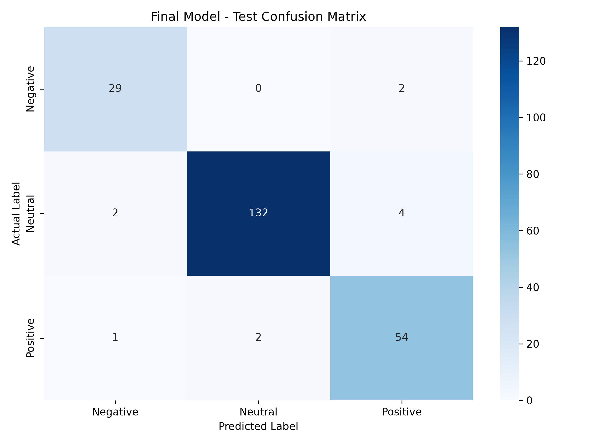

*Figure 11. Of 226 examples, 215 were classified correctly. Two Negative examples were predicted Positive, and four Neutral examples were predicted Positive.*

| Actual / predicted | Negative | Neutral | Positive |
|---|---:|---:|---:|
| Negative | 29 | 0 | 2 |
| Neutral | 2 | 132 | 4 |
| Positive | 1 | 2 | 54 |

### Statistical uncertainty

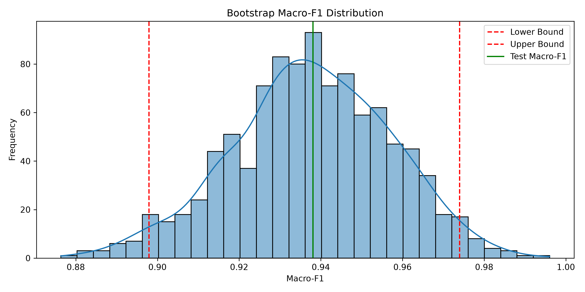

*Figure 12. A paired bootstrap with 1,000 iterations and seed 42 produced a 95% percentile interval of [0.897937, 0.973983] for test Macro-F1. The interval reflects test-sample uncertainty, not retraining or future data drift.*

### Calibration

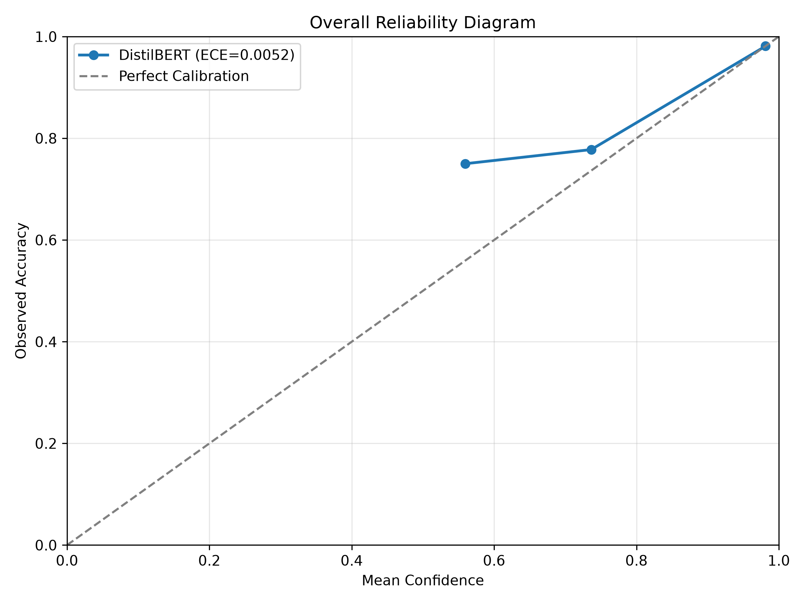

*Figure 13. The validation reliability diagram compares predicted confidence with observed accuracy. The five-bin ECE was 0.005165 on validation and 0.020372 on test.*

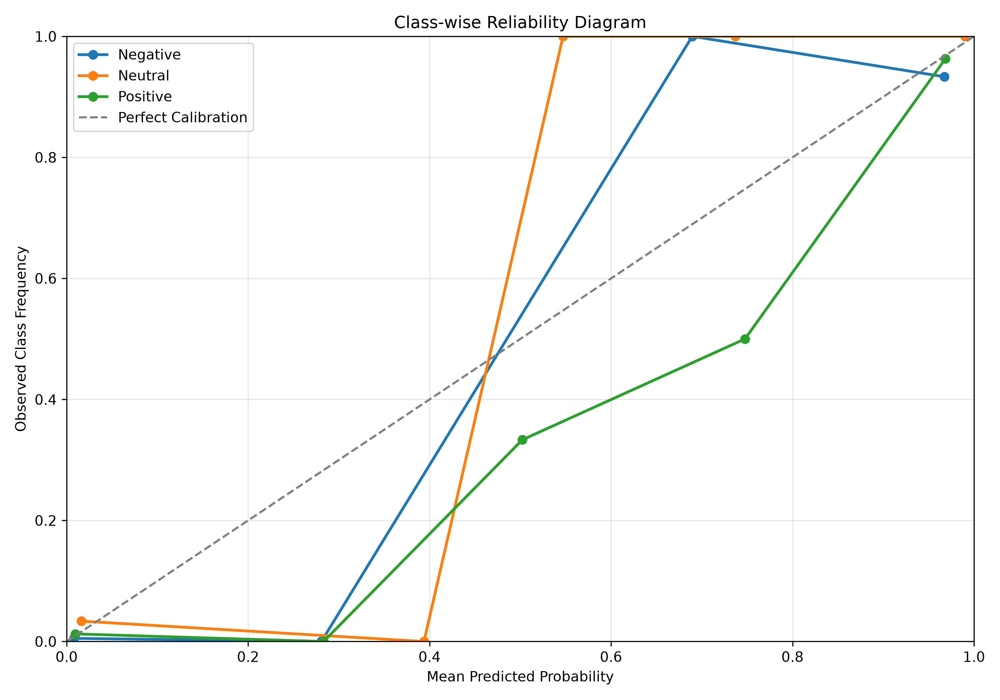

*Figure 14. Classwise calibration provides additional detail beyond the aggregate ECE: Negative 0.010792, Neutral 0.024971, Positive 0.017487 on validation.*

Low ECE on a small in-domain dataset does not establish that every confidence value is reliable, particularly under distribution shift.

## 5. Decision policy

I compared five confidence thresholds on the 226 validation examples. Coverage is the fraction accepted automatically; accepted accuracy is measured only on accepted predictions. Truncated inputs always require review regardless of confidence.

| Threshold | Coverage | Accepted accuracy | Rejected |
|---:|---:|---:|---:|
| 0.70 | 97.35% | 97.27% | 6 |
| **0.80** | **94.25%** | **98.12%** | **13** |
| 0.90 | 93.36% | 98.10% | 15 |
| 0.95 | 89.82% | 98.52% | 23 |
| 0.99 | 51.33% | 100.00% | 110 |

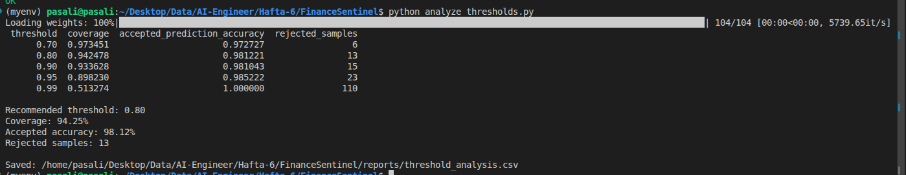

*Figure 15. A threshold of 0.80 provides the largest validation coverage among the measured thresholds that achieve at least 98% accepted accuracy. Four of the 213 accepted examples were still wrong.*

The 100% accuracy at 0.99 comes from only 116 accepted validation examples and is not a guarantee of future accuracy. The selected threshold is also not sufficient to catch high-confidence semantic errors: all seven counterfactual mismatches had confidence above 0.80.

[Threshold analysis CSV](reports/threshold_analysis.csv)

## 6. Inference performance

Measurements were collected on an NVIDIA GeForce RTX 4060 Laptop GPU. Notebook measurements used 226 validation sentences, five warm-up calls and three timed runs with CUDA synchronization. The table reports batch latency (not network or end-to-end request latency), throughput and peak allocated GPU memory. Model loading was excluded.

| Batch | Mean latency (ms) | P95 (ms) | Sentences/s | GPU memory (MB) |
|---:|---:|---:|---:|---:|
| 1 | 1.6581 | 1.9150 | 600.90 | 279.75 |
| 8 | 6.5685 | 9.1267 | 1,184.82 | 297.22 |
| 16 | 11.5064 | 14.3045 | 1,308.60 | 314.03 |
| 32 | 21.2115 | 26.7227 | **1,331.30** | 352.19 |

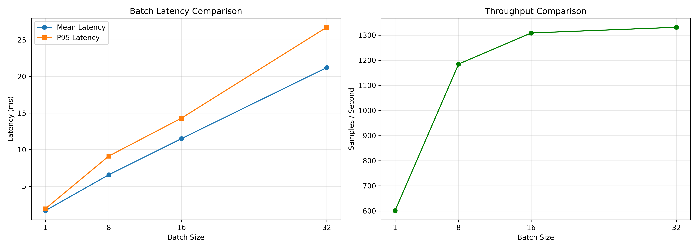

*Figure 16. Increasing batch size improves throughput but increases batch latency. Batch 16 provides a reasonable offline trade-off; batch 1 is a starting point for interactive requests.*

### Fresh-process verification

I subsequently reloaded the exported model and tokenizer in a fresh Python process and reran the four batch sizes. The recorded results were slower than the notebook measurements; both sets are reported rather than presenting the fastest run as a guaranteed performance level.

| Batch | Mean latency (ms) | P95 (ms) | Sentences/s | GPU memory (MB) |
|---:|---:|---:|---:|---:|
| 1 | 3.4680 | 4.0214 | 287.71 | 279.75 |
| 8 | 12.0025 | 21.5593 | 648.47 | 296.99 |
| 16 | 17.7292 | 22.1241 | 849.21 | 314.02 |
| 32 | 32.4985 | 42.8816 | 868.91 | 351.96 |

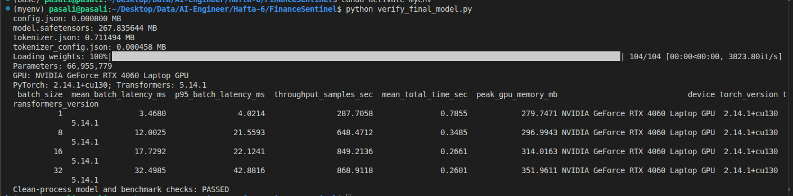

*Figure 17. The standalone verification script successfully loaded the 66,955,779-parameter model and completed all benchmark checks. The terminal records PyTorch 2.14.1+cu130 and Transformers 5.14.1.*

The benchmark is hardware-specific, not a cloud serving SLA. Token lengths, software versions, concurrency, warm-up state, and queueing can substantially affect real-world measurements.

[Notebook benchmark CSV](reports/inference_benchmark.csv) · [Fresh-process benchmark CSV](reports/inference_benchmark_clean.csv)

## 7. Robustness and error analysis

I designed ten synthetic financial sentences with expected labels assigned before inference, including controlled profit/cost counterfactuals. Only three matched the expected labels.

| Scenario | Expected | Prediction | Confidence |
|---|---|---|---:|
| Operating costs decreased by 20% | Positive | Negative | 96.93% |
| Operating costs increased by 20% | Negative | Positive | 97.42% |
| Operating profit decreased by 20% | Negative | Negative | 97.08% |
| Operating profit increased by 20% | Positive | Positive | 97.60% |
| Negation / unchanged profit | Neutral | Positive | 80.75% |
| Net loss decreased | Positive | Negative | 97.04% |
| Debt increased | Negative | Positive | 97.38% |
| Future growth target | Neutral | Positive | 97.78% |
| Realized revenue growth | Positive | Positive | 97.81% |
| Mixed sentiment | Neutral | Negative | 95.20% |

The contrast between profit and costs suggests that the model may rely on lexical shortcuts: `increased` tends toward Positive and `decreased` toward Negative, even when the financial quantity reverses the intended meaning. Six of the seven mismatches exceeded 90% confidence. The challenge set is intentionally small and difficult; its 30% score is not an estimate of population accuracy or proof of the model's internal mechanism. Mixed sentiment and future targets can also admit different human interpretations.

| Error category | Validation | Test |
|---|---:|---:|
| Cost reduction misinterpretation | 2 | 0 |
| Neutral → Positive | 4 | 4 |
| Negative → Positive | 1 | 2 |
| High-confidence errors (≥ 0.90) | 4 | 6 |
| Possible truncation errors | 0 | 0 |
| Total errors | 7 | 11 |

These categories can overlap. The test cost-reduction count was corrected from an unreviewed value to zero after inspecting all eleven errors; a risk-reduction mistake is a distinct case.

## 8. Installation and usage

Run these commands from the `FinanceSentinel/` directory using an isolated environment:

```bash
python -m venv .venv
source .venv/bin/activate
python -m pip install --upgrade pip
python -m pip install -r requirements.txt
```

On Windows PowerShell, activate with `.venv\Scripts\Activate.ps1`. For CUDA, install a compatible PyTorch build using the [official installation selector](https://pytorch.org/get-started/locally/). CPU inference is also supported. The recorded environment used Python 3.14.4, PyTorch 2.14.1+cu130 and Transformers 5.14.1; the dependency list is not a complete environment lockfile.

### Prepare the model locally

The trained weights and raw dataset are intentionally excluded from GitHub. Obtain the data from its original provider under the applicable license, reproduce the notebook workflow in order, and export the selected checkpoint using the final evaluation notebook. The CLI expects the following local files:

```text
models/financesentinel_final/
├── config.json
├── model.safetensors
├── tokenizer.json
└── tokenizer_config.json
```

The data-analysis and evaluation notebooks also require the locally prepared dataset. The inference CLI does not require the training dataset once the checkpoint has been exported. The pretrained base model alone is not a substitute for the three-class fine-tuned checkpoint.

### Interactive prediction

```bash
python -m src.predict
```

Enter one English financial sentence at a time. Type `exit` to stop.

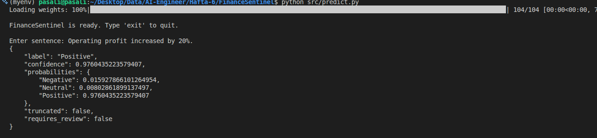

*Figure 18. The model is loaded once and reused for interactive predictions.*

### Single sentence

```bash
python -m src.predict --text "The company increased its operating profit by 15%."
```

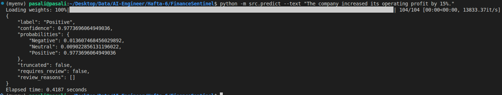

*Figure 19. The CLI returns a Positive prediction with approximately 97.74% confidence, all three class probabilities, truncation and review flags, and elapsed time.*

### Batch prediction

The input CSV must include a `text` or `sentence` column. A small synthetic example file is included in `data/sample_input.csv`.

```bash
python -m src.predict --input data/sample_input.csv --output predictions.csv
python -m src.predict --input data/sample_input.csv --output predictions.csv --batch-size 32 --device cuda
```

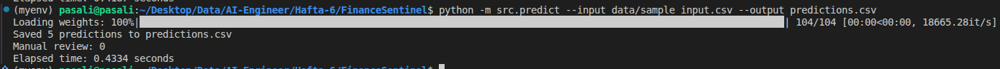

*Figure 20. The sample CSV produced five ordered predictions with no review flags in this particular run.*

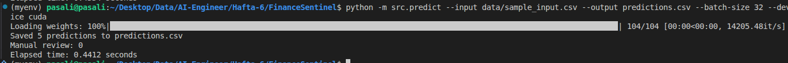

*Figure 21. The CLI supports explicit CUDA selection and configurable batch sizes. The five-row smoke test is not a throughput benchmark.*

The output contains `text`, `label`, `confidence`, three class-probability columns, `truncated`, `requires_review`, and `review_reasons`. A nonzero exit code is returned for invalid paths or malformed input. The input file cannot be overwritten by the output.

### Python interface

```python
from src.predict import FinanceSentinel

sentinel = FinanceSentinel(batch_size=16)
result = sentinel.predict("Operating profit increased by 20%.")
results = sentinel.predict_batch([
    "Revenue increased by 10%.",
    "The company reported a net loss."
])
print(result)
```

<details>
<summary>CLI help and error handling</summary>

```bash
python -m src.predict --help
```

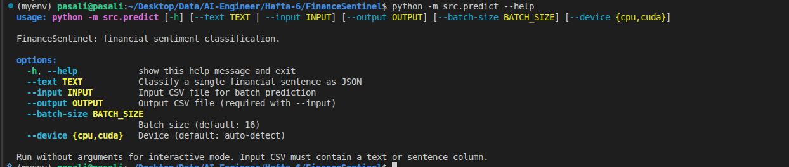

*Figure 22. The built-in argparse help lists text and CSV modes, output path, batch size, and device options.*

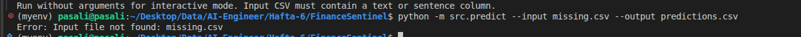

*Figure 23. An invalid input path is rejected with a clear error before inference begins.*

</details>

## 9. Automated tests

The final evaluation and application tests exercise different concerns.

| Suite | Recorded result | Purpose |
|---|---:|---|
| Day 05 model-evaluation checks | 12/12 | Reload, logits, data integrity, calibration, metric and benchmark invariants |
| Application pytest suite | 12/12 | Model loading, predictions, invalid/long input, probabilities, review policy, model reuse |

```bash
pytest tests/test_predict.py -v
pytest tests/ -v
python verify_final_model.py
python analyze_thresholds.py
```

The last two scripts require local model files and the prepared validation split. `verify_final_model.py` additionally requires CUDA and the locally generated `reports/test_predictions.csv` for split verification. The tests involving the final model require its local export. The figures below are recorded local test runs, not results from a GitHub Actions workflow.

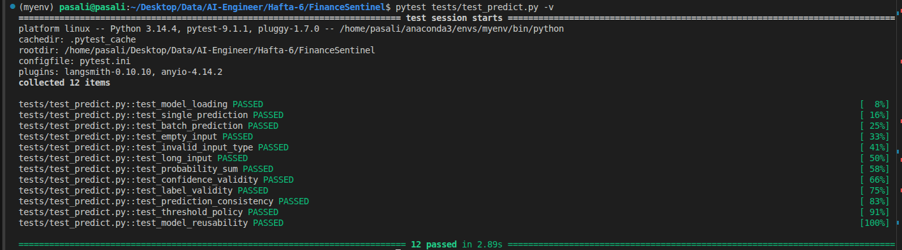

*Figure 24. All 12 production-behavior tests passed in 2.89 seconds in the recorded local run.*

<details>
<summary>Earlier application test milestones</summary>

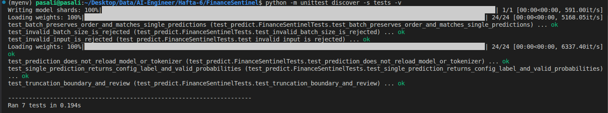

*Figure 25. The first inference-pipeline unittest suite ran seven tests covering validation, consistency, truncation, and model reuse.*

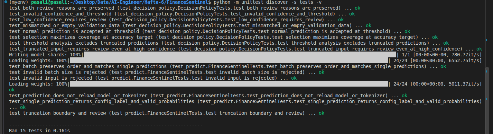

*Figure 26. The application suite expanded to 15 tests after adding the decision policy, threshold validation, and review reasons.*

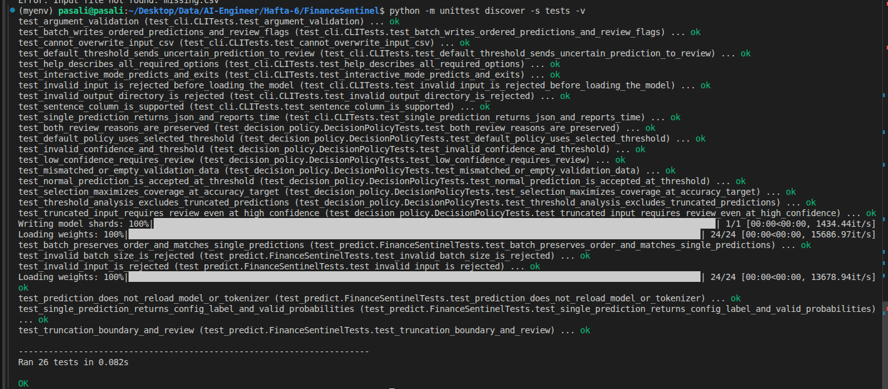

*Figure 27. The subsequent CLI, policy, and inference unittest run reported 26 successful tests. This is a historical suite result before the dedicated 12-case pytest checks, not an additional current test count.*

</details>

## 10. Project layout

```text
FinanceSentinel/
├── data/
│   └── sample_input.csv
├── notebooks/
│   ├── 01_data_analysis.ipynb
│   ├── 02_distilbert_fine_tuning.ipynb
│   ├── 03_sequence_length_experiments.ipynb
│   ├── 04_calibration_error_analysis.ipynb
│   └── 05_final_evaluation.ipynb
├── src/
│   ├── cli.py
│   ├── predict.py
│   └── decision_policy.py
├── tests/
│   ├── test_cli.py
│   ├── test_decision_policy.py
│   └── test_predict.py
├── models/                         # Local only
├── reports/
│   ├── data_card.md
│   ├── model_card.md
│   ├── day_02_distilbert_fine_tuning.md
│   ├── day_04_calibration_error_analysis.md
│   ├── day_05_final_evaluation.md
│   ├── final_error_comparison.csv
│   └── threshold_analysis.csv
├── figures/
├── analyze_thresholds.py
├── verify_final_model.py
├── pytest.ini
├── requirements.txt
├── .gitignore
└── README.md
```

### Experiment documentation

- [Data card](reports/data_card.md) — dataset selection, provenance and quality.
- [Fine-tuning report](reports/day_02_distilbert_fine_tuning.md) — the initial supervised experiment.
- [Calibration and error analysis](reports/day_04_calibration_error_analysis.md) — uncertainty and failure patterns.
- [Final evaluation](reports/day_05_final_evaluation.md) — independent test, bootstrap, benchmark and robustness details.
- [Model card](reports/model_card.md) — intended use, configuration, limitations and monitoring.

## 11. Limitations and responsible use

FinanceSentinel can support exploratory, non-commercial financial sentiment categorization of short English statements when a human reviews consequential results. It should not be used as an autonomous financial decision system.

- The dataset is small, imbalanced, high-agreement and based on a limited financial news domain. Performance on new markets, languages, full reports or recent events is not established.
- Negation, changes in costs and liabilities, future expectations and mixed financial signals are known weaknesses.
- Confidence can be high even when the financial interpretation is reversed. A threshold alone cannot make the application safe.
- Input beyond 256 tokens is truncated and flagged, not interpreted in its entirety.
- The test set is held out within the same corpus, not an external dataset. Confidence intervals address sample uncertainty, not all sources of model uncertainty.
- No concurrent-serving load test, external drift evaluation, or live production SLA has been established.

For a future deployment, I would monitor input validity, truncation rates, confidence distributions, manual-review coverage, class-specific recall, calibration, latency percentiles and drift. I would also expand contrastive test cases and evaluate against independently annotated current financial news before enabling higher-risk use.

## 12. Data and model licensing

| Component | License / distribution policy |
|---|---|
| Financial PhraseBank | [CC BY-NC-SA 3.0](https://creativecommons.org/licenses/by-nc-sa/3.0/) — attribution, non-commercial use, share-alike for applicable adaptations |
| Pretrained DistilBERT | [Apache 2.0](https://www.apache.org/licenses/LICENSE-2.0); see the [official model card](https://huggingface.co/distilbert/distilbert-base-uncased) |
| Fine-tuned weights | Kept local pending separate verification of applicable redistribution rights |
| Raw and processed financial text | Kept local by default; obtain from the original data source |

The Apache license of the pretrained model does not automatically resolve the permissions associated with the training data or the redistribution of fine-tuned weights. The dataset card directs commercial users to contact the authors. Before distributing model weights or licensed material, review all applicable rights and obtain permission where required. No new license is asserted for the project source code here.

The repository is intended to share source code, synthetic examples, aggregate measurements and safe visualizations. Notebook outputs and row-level prediction/error exports containing corpus text should be excluded from public commits unless their redistribution rights have been verified.

When publishing, inspect staged files (`git diff --cached --stat`) and verify that raw data and weights are not already tracked. Save a private copy of the original notebooks, then clear outputs in the copies intended for GitHub and inspect their source cells for embedded corpus text. `.gitignore` does not retroactively remove previously tracked data or weights.

## References

- Malo, P., Sinha, A., Korhonen, P., Wallenius, J., & Takala, P. (2014). [Good debt or bad debt: Detecting semantic orientations in economic texts](https://arxiv.org/abs/1307.5336).
- [Financial PhraseBank — dataset card](https://huggingface.co/datasets/takala/financial_phrasebank)
- Sanh, V. et al. (2019). [DistilBERT, a distilled version of BERT: smaller, faster, cheaper and lighter](https://arxiv.org/abs/1910.01108).
- [DistilBERT base model](https://huggingface.co/distilbert/distilbert-base-uncased)

---

Built by **Alpay Paşalı** as part of my AI Engineering learning journey. The key lesson from FinanceSentinel was that a useful ML system requires much more than a trained model: evaluation, uncertainty, failure analysis, reproducible inference and clear boundaries are equally important.
