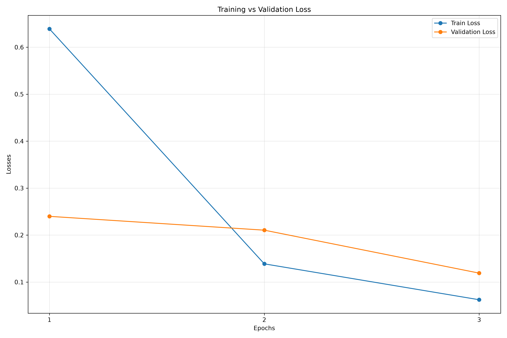
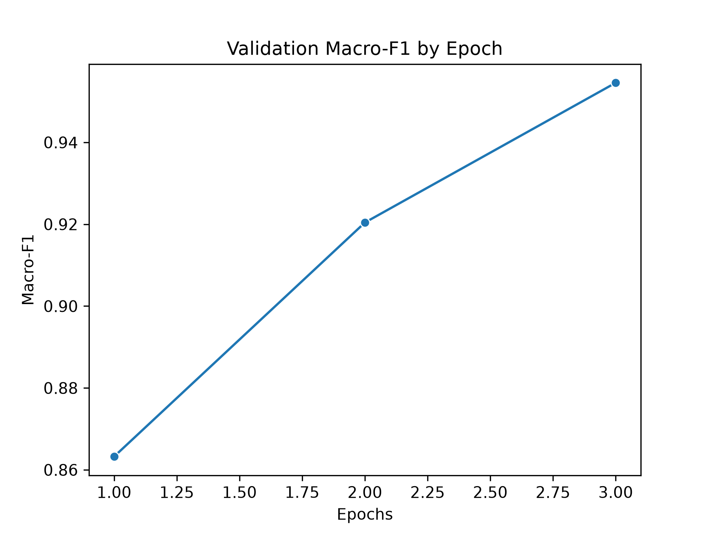

# FinanceSentinel — Day 02: DistilBERT Fine-Tuning

**Date:** 2026-11-17  
**Notebook:** `notebooks/02_distilbert_fine_tuning.ipynb`  
**Evaluation split:** Validation only

## 1. Objective

Fine-tune DistilBERT to classify English financial sentences as Negative (0), Neutral (1), or Positive (2). Macro-F1 is the primary model-selection metric because the classes are imbalanced. Accuracy and class-specific Recall provide additional information, especially for the minority Negative class.

## 2. Data Preparation

The `sentences_allagree` configuration of Financial PhraseBank was selected on Day 01 for its high annotation agreement. Five duplicate sentences were removed before splitting, leaving 2,259 unique examples. No missing or conflicting labels were identified in this configuration.

Two stratified splits with `random_state=42` were used to create the 80/10/10 partition.

| Split | Examples | Negative (%) | Neutral (%) | Positive (%) |
|---|---:|---:|---:|---:|
| Train | 1,807 | 13.39 | 61.37 | 25.24 |
| Validation | 226 | 13.27 | 61.50 | 25.22 |
| Test | 226 | 13.72 | 61.06 | 25.22 |
| Total | 2,259 | | | |

All three classes are represented in every split. Exact sentence intersections between train, validation and test are empty. The test set was not used for model selection or final performance evaluation.

## 3. Tokenization

The pretrained `distilbert-base-uncased` tokenizer converts sentences to input IDs and attention masks. DataFrames were converted to Hugging Face datasets and grouped in a `DatasetDict`. Tokenization was applied with `map(batched=True)`.

| Setting | Value |
|---|---|
| Maximum sequence length | 128 tokens (including special tokens) |
| Truncation | Enabled |
| Padding during tokenization | Disabled |
| Batch padding | Dynamic (`DataCollatorWithPadding`) |
| Token type IDs | Disabled; not required by DistilBERT |

In a three-example batch with original token lengths of 38, 24 and 14, dynamic padding produced input and mask tensors of shape `(3, 38)`. The number of non-padding tokens was 76; 38 padding positions were added. Fixed padding to 128 would have required 384 positions instead of 114. Dynamic padding can reduce computation and activation memory, although actual GPU savings depend on the attention implementation and hardware.

## 4. Model Architecture

`AutoModelForSequenceClassification` loaded DistilBERT with three output classes. The pretrained encoder was retained, while the task-specific classification head was newly initialized. All parameters remained trainable for full fine-tuning.

| Property | Value |
|---|---:|
| Transformer layers | 6 |
| Hidden size | 768 |
| Attention heads | 12 |
| Total parameters | 66,955,779 |
| Trainable parameters | 66,955,779 |
| Encoder parameters | 66,362,880 |
| Pre-classifier parameters | 590,592 |
| Final classifier parameters | 2,307 |
| Classification head parameters | 592,899 |
| Trainable parameter ratio | 100% |

The classification head maps the first token representation through a 768-to-768 linear layer, ReLU, dropout, and a 768-to-3 classifier. A three-example forward pass produced logits of shape `(3, 3)`. Cross-entropy uses raw logits, while softmax is used to inspect class probabilities.

## 5. Training Configuration

| Hyperparameter | Value | Rationale |
|---|---|---|
| Epochs | 3 | Initial fine-tuning budget; monitor validation performance |
| Learning rate | 2e-5 | Conservative updates to pretrained weights |
| Train batch size | 16 | Balance GPU memory and gradient estimation |
| Evaluation batch size | 16 | Consistent batched validation |
| Weight decay | 0.01 | Regularization of applicable weights |
| Warmup ratio | 0.1 | Gradually increase learning rate initially |
| LR scheduler | Linear | Gradually reduce learning rate after warmup |
| Gradient accumulation | 1 | One optimizer update per training batch |
| Evaluation / save / logging | Each epoch | Compare and retain epoch-level checkpoints |
| Best model metric | Macro-F1 | Equal weighting of the three classes |
| Load best model at end | True | Retain the best validation checkpoint |
| Trainer seed | 42 | Improve reproducibility of the training process |
| Device | CUDA:0 | GPU training |

Training used Hugging Face `Trainer`, dynamic padding and a custom `compute_metrics` function. The metrics include Accuracy, Macro Precision, Macro Recall, Macro-F1 and per-class Recall.

There were 113 training batches per epoch and 15 validation batches. The planned total of 339 optimizer steps (113 × 3) was confirmed by the training progress. The theoretical warmup length is 34 steps (`ceil(339 × 0.1)`). Epoch-end logged learning rates were consistent with this schedule; the full warmup trace was not recorded. Training took approximately 18.50 seconds on the local GPU.

## 6. Baseline

The majority baseline predicts the majority class in the training data (Neutral, label 1) for every validation sentence, without examining its text. It was evaluated on the same 226 validation examples as DistilBERT.

| Model | Accuracy | Macro-F1 |
|---|---:|---:|
| Majority classifier | 0.615044 | 0.253881 |
| Fine-tuned DistilBERT | 0.964602 | 0.954557 |

DistilBERT improves validation accuracy by about 34.96 percentage points and Macro-F1 by 70.07 percentage points. The majority classifier's accuracy illustrates why accuracy alone is misleading on this dataset.

## 7. Training Results

| Epoch | Train Loss | Validation Loss | Accuracy | Macro-F1 |
|---:|---:|---:|---:|---:|
| 1 | 0.639013 | 0.239885 | 0.898230 | 0.863248 |
| 2 | 0.138751 | 0.210456 | 0.929204 | 0.920412 |
| 3 | 0.062318 | 0.118998 | 0.964602 | **0.954557** |

| Epoch | Negative Recall | Neutral Recall | Positive Recall | Macro Recall | Macro Precision |
|---:|---:|---:|---:|---:|---:|
| 1 | 0.900000 | 0.928058 | 0.824561 | 0.884206 | 0.846498 |
| 2 | 0.933333 | 0.913669 | 0.964912 | 0.937305 | 0.910145 |
| 3 | 0.966667 | 0.971223 | 0.947368 | 0.961753 | 0.947795 |

Both training and validation loss decreased across the three epochs, while validation Macro-F1 increased. No clear evidence of overfitting was observed during this run. Positive Recall decreased slightly from epoch 2 to epoch 3, even though Macro-F1 improved.





## 8. Model Selection

Epoch 3 (`checkpoint-339`) achieved the highest validation Macro-F1 (0.954557), and also the lowest validation loss (0.118998). It is the selected checkpoint for subsequent experiments. Macro-F1 remains the primary selection criterion even if the minimum validation loss and maximum Macro-F1 occur at different epochs.

The training configuration restores the best checkpoint at the end. To keep a separate reusable model and tokenizer directory, run the following in the notebook:

```python
trainer.save_model("../models/distilbert_best")
tokenizer.save_pretrained("../models/distilbert_best")
```

The checkpoint files remain local; the separate export must be run and verified in the training environment.

## 9. Limitations

- The dataset is relatively small, imbalanced, English-only and restricted to high-agreement financial news sentences.
- Only exact sentence duplication was checked; near-duplicates or shared news sources could still affect generalization.
- The 128-token limit may truncate relevant context in longer financial text.
- A single training run and validation split do not establish robustness across random seeds, time periods or unseen financial domains.
- High softmax confidence does not guarantee calibrated predictions. Calibration and qualitative error analysis remain future work.
- The reported metrics are validation results, not an independent test-set estimate. The test split remains reserved for final evaluation.
- Trainer seed was configured; reproducible future runs should also seed the random classification head before model initialization and record package versions and hardware.
- The dataset's usage and distribution restrictions are discussed in `reports/data_card.md`. Model files and raw data should remain local unless redistribution rights have been verified.

## 10. Tests

Eight assertion checks were prepared in the notebook. The table distinguishes observations already supported by notebook outputs from checks whose final execution output has not yet been provided.

| Test | Expected result | Evidence / status |
|---|---|---|
| Split Size | 2,259 total examples | Verified by split sizes: 1,807 + 226 + 226 |
| Data Leakage | Empty pairwise intersections | Verified: all three exact intersections are zero |
| Class Coverage | Labels 0, 1 and 2 in every split | Verified by reported class distributions |
| Token Length | Maximum 128 tokens | Configured; full dataset assertion output pending |
| Logits Shape | `(batch_size, 3)` | Verified by three-example forward-pass output |
| Probability | Each row sums to approximately 1 | Assertion provided; final execution output pending |
| Training Loss | All loss values finite | All reported epoch losses are finite |
| Baseline | DistilBERT Macro-F1 exceeds majority Macro-F1 | Verified: 0.954557 > 0.253881 |

The complete assertion suite must be run locally to confirm all eight tests pass. These checks do not evaluate model performance on the test split.

## 11. Artifacts

- `reports/split_distribution.csv`
- `reports/training_history.csv`
- `reports/baseline_comparison.csv`
- `figures/training_loss.png`
- `figures/validation_f1.png`
- `models/distilbert/checkpoint-339/` (selected training checkpoint)
- `models/distilbert_best/` (planned reusable export)

