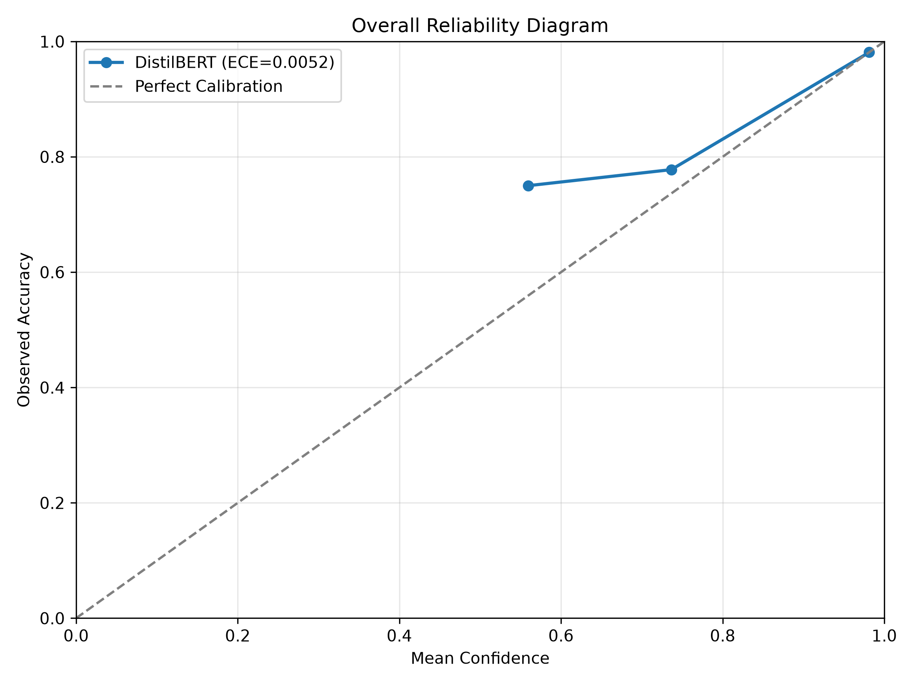
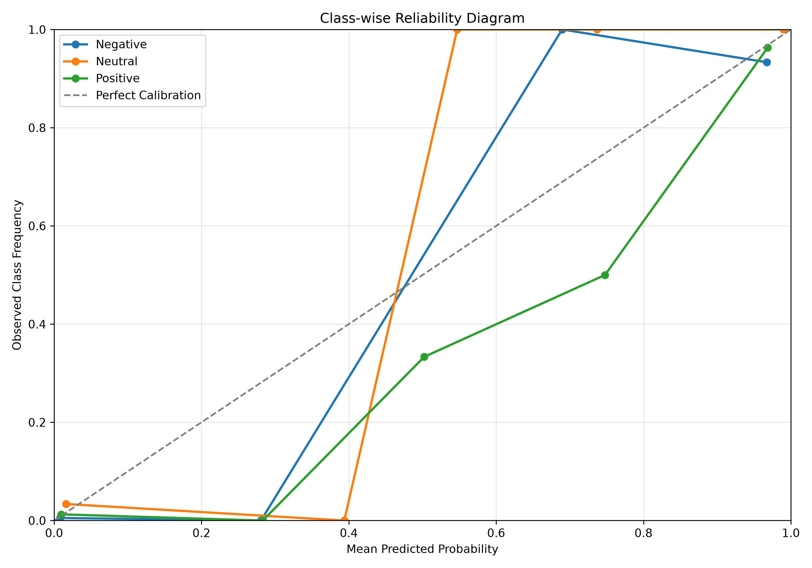
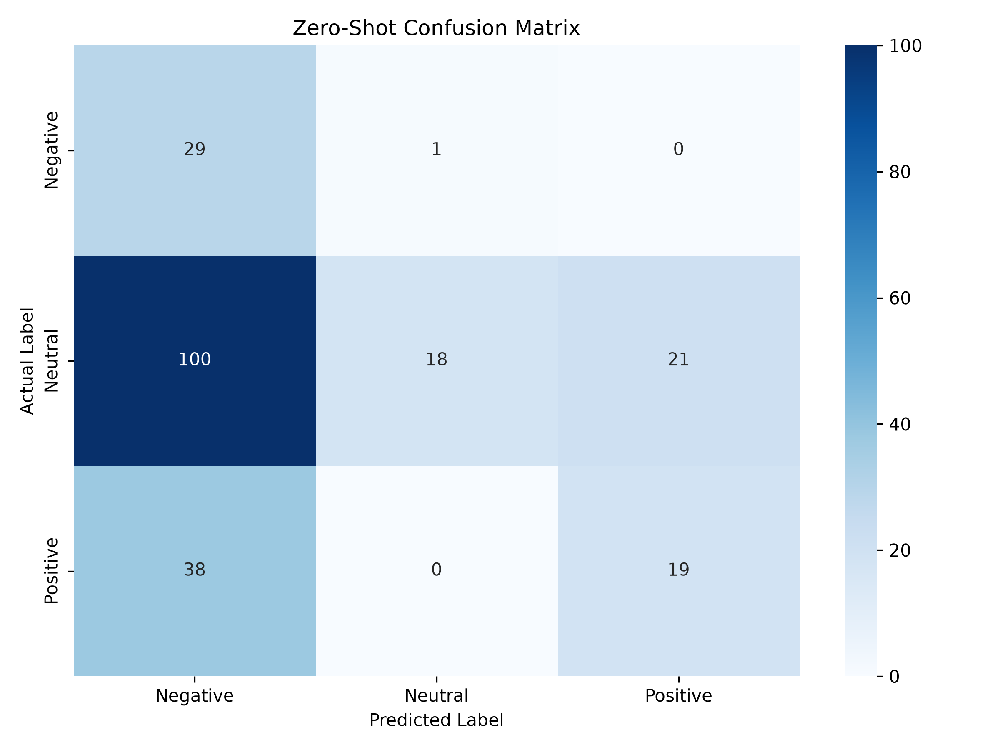
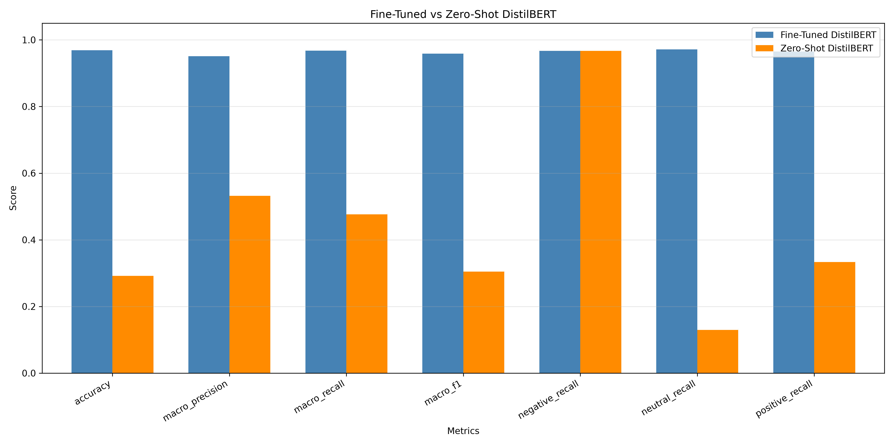

# FinanceSentinel — Day 04: Calibration and Error Analysis

**Date:** 2026-11-19  
**Notebook:** `notebooks/04_calibration_error_analysis.ipynb`  
**Evaluation split:** Validation only

## 1. Objective

Evaluate the reliability of the DistilBERT checkpoint selected on Day 03, beyond its classification metrics. Analyze confidence, overall and class-wise calibration, individual prediction errors, and the performance of an NLI-based zero-shot baseline under fixed evaluation conditions. No model weights, temperature parameter, or decision thresholds were optimized during this session.

## 2. Checkpoint

The selected 256-token model was reloaded from `models/length_resource_experiment_256/checkpoint-339`, together with its saved tokenizer.

| Property | Value |
|---|---|
| Architecture | DistilBERT |
| Base model | `distilbert-base-uncased` |
| Parameters | 66,955,779 |
| Transformer layers / hidden size / heads | 6 / 768 / 12 |
| Labels | 0: Negative, 1: Neutral, 2: Positive |
| Maximum model positions | 512 |
| Tokenization limit | 256 |
| Evaluation batch size | 16 |
| Execution | CUDA, `model.eval()` and `torch.no_grad()` |

The checkpoint configuration and label mapping were inspected. Inference used dynamic padding, truncation and an unshuffled DataLoader. The resulting logits had shape `(226, 3)` and the labels had shape `(226,)`.

## 3. Validation Data

The Financial PhraseBank `sentences_allagree` dataset was deduplicated by sentence (2,264 to 2,259 examples) and the original stratified 80/10/10 split was reproduced using seed 42.

| Split | Examples | Used today |
|---|---:|---|
| Train | 1,807 | No |
| Validation | 226 | Yes |
| Test | 226 | No |

Validation contained 30 Negative, 139 Neutral and 57 Positive examples. The sentences, row order and labels were checked against the Day 03 prediction file. All 226 predicted class IDs matched the saved 256-token predictions. Accuracy and Macro-F1 were reproduced at 0.969027 and 0.958797, respectively. The test set remains untouched for independent evaluation.

## 4. Confidence Analysis

Softmax was applied across the three logits for each example. The maximum class probability was used as top-label confidence. Argmax identifies the predicted class; the same class should be selected before and after softmax. Correct and incorrect predictions were separated using boolean masks.

| Statistic | Correct predictions | Incorrect predictions |
|---|---:|---:|
| Count | 219 | 7 |
| Mean | 0.968019 | 0.843052 |
| Median | 0.991638 | 0.935531 |
| Minimum | 0.562891 | 0.494969 |
| Maximum | 0.994631 | 0.973275 |
| Standard deviation | 0.067903 | 0.173471 |

Correct predictions had higher average confidence, but the model also made errors at confidence levels above 90%. The maximum confidence among incorrect predictions was 97.33%. High confidence is therefore not a guarantee of correctness.

Artifact: `reports/confidence_analysis.csv`.

## 5. Calibration

Overall top-label ECE was calculated manually using five equal-width confidence bins:

`ECE = sum((n_bin / N) * abs(observed_accuracy - mean_confidence))`

The first interval includes zero; all subsequent intervals exclude the lower boundary and include the upper boundary. Empty bins contribute zero to ECE, but their mean confidence and observed accuracy are undefined and are recorded as `NaN`.

| Confidence interval | Count | Mean confidence | Observed accuracy |
|---|---:|---:|---:|
| 0.0–0.2 | 0 | — | — |
| 0.2–0.4 | 0 | — | — |
| 0.4–0.6 | 4 | 0.559474 | 0.750000 |
| 0.6–0.8 | 9 | 0.736355 | 0.777778 |
| 0.8–1.0 | 213 | 0.981373 | 0.981221 |

**Overall ECE: 0.005165 (0.52 percentage points).**

The dominant confidence bin contains 213 of 226 examples and has closely matched confidence and accuracy. The two smaller populated bins exhibit observed underconfidence, but contain only four and nine examples. The small overall ECE is encouraging for this validation set and binning scheme, not proof of calibration across all subgroups. High-confidence errors can coexist with low aggregate ECE.

## 6. Class-wise Calibration

One-vs-rest calibration was computed using all 226 probabilities for each class, with binary targets indicating whether the actual class matched that class. In these calculations the observed frequency is the fraction of actual positives in a bin, not the top-label accuracy or the class recall.

| Class | Mean predicted probability | Actual class rate | Class-wise ECE |
|---|---:|---:|---:|
| Negative | 0.140787 | 0.132743 | 0.010792 |
| Neutral | 0.593558 | 0.615044 | 0.024971 |
| Positive | 0.265655 | 0.252212 | 0.017487 |
| Macro class-wise ECE | — | — | 0.017750 |

Negative has the lowest measured class-wise ECE and Neutral the highest. In the highest Negative probability bin, 30 examples had mean probability 0.967163 and observed class frequency 0.933333, indicating mild overprediction in that bin. Neutral probabilities are lower than the observed Neutral prevalence on average. Positive probabilities are higher than their observed prevalence on average. These aggregate differences do not establish uniform underconfidence or overconfidence across all bins.

The three classes must be assessed independently: top-label ECE can conceal class-specific probability errors. No statistical significance is claimed for their ECE differences. In particular, the validation set has only 30 true Negative examples, even though all 226 probabilities enter Negative calibration.

## 7. Error Analysis

Seven incorrect predictions were reviewed locally. This table contains only row IDs, labels, scores and paraphrased hypotheses, not raw dataset sentences.

| Validation row ID | Actual | Predicted | Confidence | Tokens | Possible explanation |
|---:|---|---|---:|---:|---|
| 149 | Negative | Positive | 0.973275 | 62 | Misinterpretation of increasing net loss |
| 31 | Positive | Negative | 0.967017 | 14 | Cost reduction interpreted as negative |
| 180 | Positive | Negative | 0.954615 | 33 | Cost savings interpreted as negative |
| 10 | Neutral | Positive | 0.935531 | 19 | Price advantage interpreted as positive financial sentiment |
| 172 | Neutral | Positive | 0.788960 | 25 | Project activity interpreted as positive sentiment |
| 190 | Neutral | Positive | 0.787000 | 34 | Growth target or necessity interpreted as realized growth |
| 146 | Neutral | Positive | 0.494969 | 36 | Financial figures without a clear directional comparison |

Four errors have confidence above 0.90. Neutral-to-Positive is the most common error direction (four examples), followed by Positive-to-Negative (two) and Negative-to-Positive (one). Row 149 is the highest-confidence error and represents a particularly relevant missed negative signal.

The cost-related errors suggest a possible shortcut involving words that express a decrease, rather than the financial meaning of the quantity that decreased. This is a hypothesis, not a demonstrated causal explanation. Future counterfactual tests could contrast increases and decreases in costs versus profits under otherwise equivalent wording. Ambiguous labels should be reviewed independently without changing the gold labels merely to match model predictions.

All seven error examples are shorter than 128 tokens, so there is no evidence that the 256-token truncation limit caused these errors. Row 146 is especially uncertain, with Positive and Neutral scores of approximately 0.495 and 0.490.

Artifact: `reports/error_analysis.csv` (without raw financial text).

## 8. Zero-Shot Model

The baseline is `typeform/distilbert-base-uncased-mnli`, a DistilBERT checkpoint fine-tuned on MNLI rather than on this financial sentiment task. The fixed Hugging Face zero-shot pipeline configuration was:

| Setting | Value |
|---|---|
| Candidate labels | negative, neutral, positive |
| Hypothesis template | `The financial sentiment of this statement is {}.` |
| Multi-label | False |
| Evaluation examples | Same 226 validation sentences |
| Label mapping | negative=0, neutral=1, positive=2 |

The candidate with the highest score was mapped to its numerical class ID. The model was not fine-tuned on Financial PhraseBank and no alternative templates were selected after viewing the results. The scores are normalized candidate entailment scores, not necessarily calibrated financial sentiment probabilities.

## 9. Model Comparison

| Metric | Fine-tuned DistilBERT | Zero-shot DistilBERT |
|---|---:|---:|
| Samples | 226 | 226 |
| Accuracy | 0.969027 | 0.292035 |
| Macro Precision | 0.950717 | 0.532007 |
| Macro Recall | 0.967601 | 0.476499 |
| Macro-F1 | 0.958797 | 0.304672 |
| Negative Recall | 0.966667 | 0.966667 |
| Neutral Recall | 0.971223 | 0.129496 |
| Positive Recall | 0.964912 | 0.333333 |

Fine-tuned DistilBERT correctly classified 219 examples, compared with 66 for the zero-shot model. The Macro-F1 advantage is approximately 65.41 percentage points.

| Actual / predicted (zero-shot) | Negative | Neutral | Positive |
|---|---:|---:|---:|
| Negative | 29 | 1 | 0 |
| Neutral | 100 | 18 | 21 |
| Positive | 38 | 0 | 19 |

The zero-shot model predicted Negative 167 times (73.89% of samples), including 138 false positives. Both models have the same Negative Recall, but Negative precision is 29/167 = 17.37% for zero-shot versus 29/31 = 93.55% for the fine-tuned model. The fine-tuned model is the preferred candidate for further validation because of its balanced class performance and much lower false-alert burden. This result does not establish that all zero-shot models are inferior, or isolate the effect of fine-tuning from every other checkpoint difference.

Artifact: `reports/fine_tuned_vs_zero_shot.csv`.

## 10. Limitations

**Does a validation Macro-F1 of approximately 95.9% prove that FinanceSentinel can reliably classify real financial texts? No.** It demonstrates strong performance on the selected validation split, not production readiness.

- **Calibration:** The measured ECE is low, but it depends on the five-bin choice and small sample size. Seven errors remain, four with confidence above 90%. The model has not been calibrated using temperature scaling, and low ECE does not eliminate high-confidence mistakes.
- **Validation reuse:** This split was used for model and sequence-length selection, so its performance may be optimistic. The untouched 226-example test set is required for independent final evaluation after all decisions are fixed.
- **Data distribution:** Financial PhraseBank is small, imbalanced, English-only and filtered for high annotator agreement. Real financial texts can be longer, ambiguous or contain domain-specific jargon, multiple companies and mixed sentiment.
- **Domain and temporal shift:** Financial terminology, news composition, class prevalence and the relationship between language and sentiment may change. Independent data from relevant sources and later periods would provide stronger evidence of generalization.
- **Error and label quality:** The semantic error explanations are hypotheses based on seven examples. Counterfactual tests and independent label review are needed before drawing causal conclusions.
- **Zero-shot baseline:** Only one MNLI checkpoint, label set and template were tested. No claim is made about the best possible zero-shot setup or comparative calibration or latency, which were not measured today.
- **Operational reliability:** Before deployment, evaluate false-negative and false-positive costs, risk-based review policies, latency, data drift and calibration drift. Monitor performance using newly labeled samples. A confidence threshold alone cannot prevent confidently wrong predictions.
- **Data sharing:** Raw Financial PhraseBank sentences and notebook outputs containing them should not be published without verifying redistribution rights. Keep local checkpoint and raw data files out of repository commits unless their release is authorized.

## 11. Tests

Eight automated assertion groups were prepared in the notebook. The following table separates observed outputs from the status of the final test suite; the user's final eight-test execution output has not yet been supplied.

| Test | Expected result | Evidence / status |
|---|---|---|
| 1. Checkpoint | Correct DistilBERT path, three labels, 256-token setting | Model load and configuration observed; final assertion output pending |
| 2. Validation Integrity | Same sentences, order, labels and predictions | Equality checks observed; 226 matching predictions |
| 3. Logits Shape | `(226, 3)` and finite values | Shape observed; final assertion output pending |
| 4. Probability | Values in [0, 1], every row sums to approximately 1 | Probability output observed; final assertion output pending |
| 5. Confidence | Valid finite maximum class probabilities | Confidence analysis observed; final assertion output pending |
| 6. Calibration | Valid ECE, correct bin coverage, hand-computed reference test | Model ECE and bin counts observed; synthetic assertion output pending |
| 7. Error Consistency | Seven errors match confusion matrix and report | Seven error rows observed; final assertion output pending |
| 8. Zero-Shot Alignment | Same 226 sentences and true labels, valid predicted IDs | Counts and metrics observed; full alignment assertion output pending |

The synthetic calibration test uses confidence `[0.6, 0.6, 0.9, 0.9]` and correctness `[1, 0, 1, 1]`. The manually calculated expected ECE is 0.10. The test suite must be executed and its output verified locally before recording that all eight tests passed. These checks are not a substitute for independent test-set evaluation.

## 12. What I Learned

- Confidence describes the probability score assigned to a prediction; calibration evaluates whether scores match observed frequencies.
- Accuracy, Macro-F1, recall and calibration provide complementary information. Equal Negative Recall can conceal very different false-positive rates.
- Implementing ECE from scratch requires correct boundaries, sample weighting and explicit handling of empty bins.
- Overall calibration does not guarantee that individual classes or individual predictions are reliable.
- Error analysis can identify hypotheses about financial semantics and guide targeted robustness tests.
- A fair comparison uses the same examples and metrics with fixed experimental conditions; domain-specific fine-tuning performed substantially better than the tested zero-shot configuration.
- Validation results support model selection, but independent test and domain-relevant evaluation are necessary before deployment.

## 13. Artifacts

- `notebooks/04_calibration_error_analysis.ipynb`
- `reports/confidence_analysis.csv`
- `reports/error_analysis.csv`
- `reports/fine_tuned_vs_zero_shot.csv`
- `figures/reliability_diagram.png`
- `figures/classwise_calibration.png`
- `figures/zero_shot_confusion_matrix.png`
- `figures/model_comparison.png`
