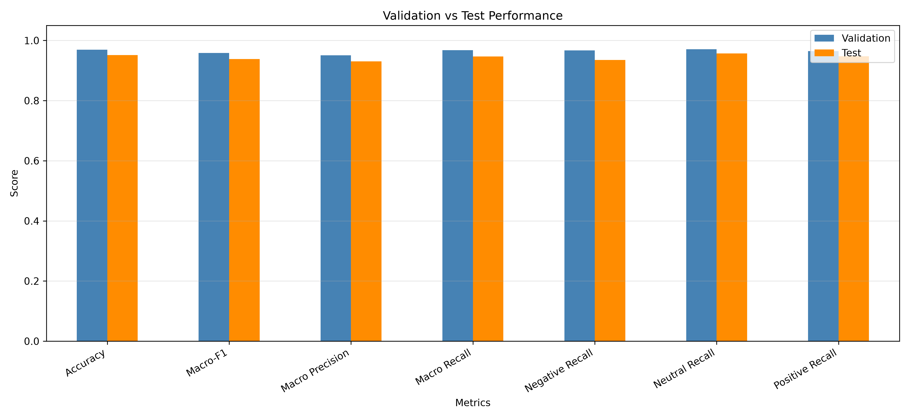
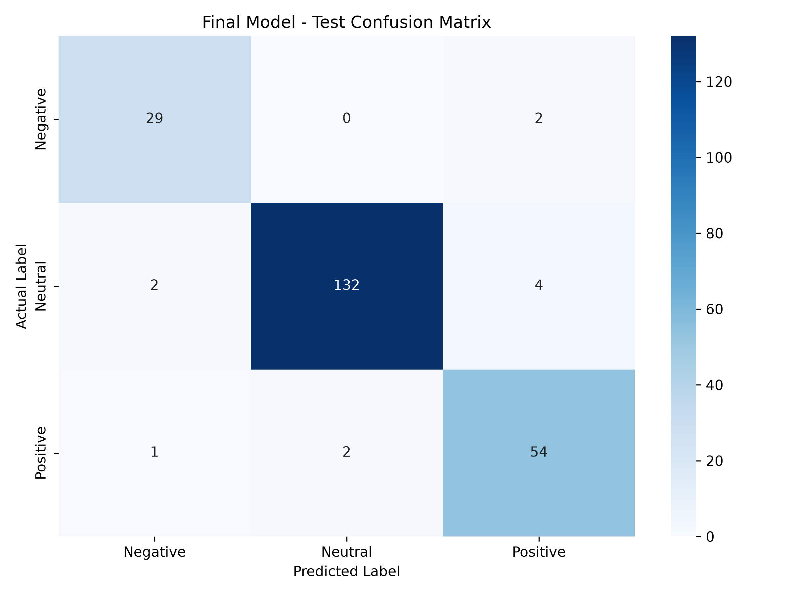
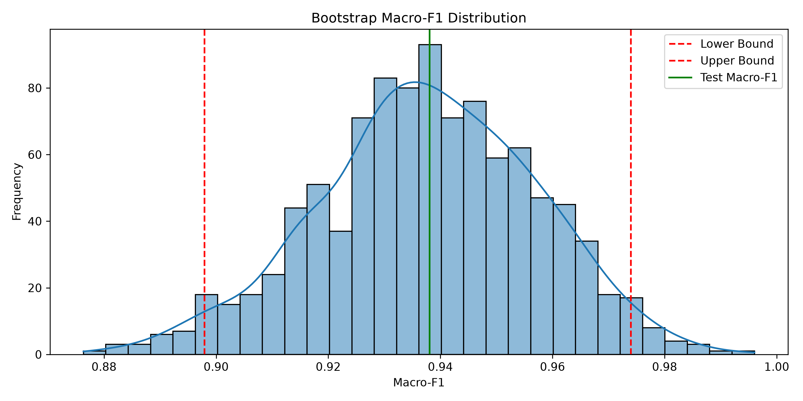
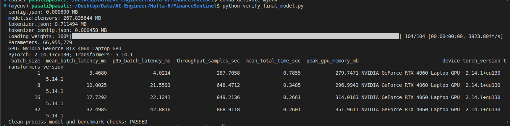
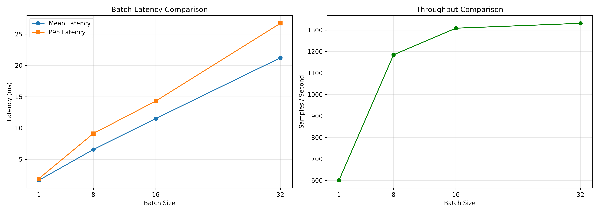

# FinanceSentinel — Day 05: Final Evaluation

**Date:** 2026-11-20  
**Notebook:** `notebooks/05_final_evaluation.ipynb`  
**Evaluation:** Independent test, inference benchmark and robustness analysis

## 1. Objective

Today I finalized the DistilBERT model, evaluated it on the previously reserved test set, measured inference performance, and investigated its behavior on difficult financial statements. The purpose was to understand whether a model with strong validation results could also generalize to unseen examples and handle realistic financial language reliably.

## 2. Final Model Selection

I selected `models/length_resource_experiment_256/checkpoint-339` based on its validation Macro-F1 of 0.958797 and exported the model and tokenizer to `models/financesentinel_final/`.

| Model configuration | Validation Accuracy | Validation Macro-F1 | Training time (s) | Peak training GPU memory (MB) |
|---|---:|---:|---:|---:|
| Max length 128 | 0.964602 | 0.949958 | 18.043863 | 1514.970624 |
| Max length 256 | 0.969027 | **0.958797** | 18.087495 | 1633.617408 |

The 256-token model achieved a 0.88 percentage-point improvement in Macro-F1 at the cost of approximately 119 MB of additional peak GPU memory. Both models trained for three epochs and 339 optimizer steps. Because all validation sentences were shorter than 128 tokens, the difference cannot be attributed directly to retaining more validation text. Multiple training seeds would be needed to establish whether the improvement is consistent.

The final model contains 66,955,779 FP32 parameters, six Transformer layers, and a hidden size of 768. The weights were exported using Safetensors. The save/reload test on 20 fixed validation examples passed: logits and softmax probabilities matched within tolerance (`atol=1e-6`, `rtol=1e-5`) and predicted labels matched exactly.

| Final export file | Size (MB) |
|---|---:|
| `config.json` | 0.0008 |
| `tokenizer.json` | 0.7115 |
| `tokenizer_config.json` | 0.0005 |
| `model.safetensors` | 267.835644 |
| Total folder | 268.548396 |

The theoretical FP32 weight size is 267.823116 MB; the small difference from the serialized weight file is consistent with format metadata and tensor headers.

The checkpoint was selected before evaluating the test set. No additional model selection or tuning was performed using test performance.

## 3. Independent Test Evaluation

The original stratified split (seed 42) was preserved after removing duplicate sentences from Financial PhraseBank.

| Split | Samples | Purpose |
|---|---:|---|
| Train | 1,807 | Parameter learning |
| Validation | 226 | Model selection and analysis |
| Test | 226 | Independent final evaluation |
| Total | 2,259 | |

The final model processed the 226 test sentences in batches of 16. Each example produced three logits, three probabilities, a predicted label and a confidence score. The model correctly classified 215 sentences and misclassified 11.

| Metric | Validation | Test | Difference (test − validation) |
|---|---:|---:|---:|
| Accuracy | 0.969027 | 0.951327 | -0.017700 |
| Macro-F1 | 0.958797 | 0.938100 | -0.020697 |
| Macro Precision | 0.950717 | 0.930442 | -0.020275 |
| Macro Recall | 0.967601 | 0.946458 | -0.021143 |
| Negative Recall | 0.966667 | 0.935484 | -0.031183 |
| Neutral Recall | 0.971223 | 0.956522 | -0.014701 |
| Positive Recall | 0.964912 | 0.947368 | -0.017544 |
| ECE (5 bins) | 0.005165 | 0.020372 | +0.015207 |

The test Macro-F1 of 93.81% is approximately 2.07 percentage points lower than the validation result. This is a promising result for the held-out portion of Financial PhraseBank. However, the test set originates from the same corpus as the training data; therefore, this evaluation does not establish generalization to real-time financial news, different sources, or new economic conditions.

The overall five-bin test ECE increased from 0.005165 to 0.020372. I verified this value against the saved test predictions. This indicates a larger observed calibration gap on the test split, but it should be interpreted in light of the small sample size and binning choice.

### Test confusion matrix

Rows are actual labels and columns are predicted labels.

| Actual / Predicted | Negative | Neutral | Positive | Support |
|---|---:|---:|---:|---:|
| Negative | 29 | 0 | 2 | 31 |
| Neutral | 2 | 132 | 4 | 138 |
| Positive | 1 | 2 | 54 | 57 |
| Total | 32 | 134 | 60 | 226 |

The Negative class has the fewest test examples and the largest recall decrease relative to validation. Neutral-to-Positive was the most frequent individual error direction. Although overall accuracy remains high, the two Negative-to-Positive mistakes are particularly important in a financial context.

## 4. Statistical Reliability

I used paired bootstrap resampling to estimate the sampling uncertainty of the test Macro-F1. Each of the 1,000 bootstrap samples contains 226 observations sampled with replacement, preserving the pairing between actual labels and model predictions. Seed 42 was used throughout.

| Statistic | Result |
|---|---:|
| Test Macro-F1 | 0.938100 |
| Bootstrap iterations | 1,000 |
| Bootstrap mean | 0.937704 |
| 95% percentile interval — lower bound | 0.897937 |
| 95% percentile interval — upper bound | 0.973983 |

The estimated interval ranges from approximately 89.79% to 97.40%. The bootstrap mean is close to the observed score, while the interval width of about 7.60 percentage points highlights the uncertainty associated with a relatively small test set. The result does not measure variation across model retraining, data sources, or future financial conditions.

## 5. Training and Inference Cost

The selected model took approximately 18.09 seconds to train on the local GPU and used 1,633.62 MB of peak allocated GPU memory during training. These measurements reflect the specific dataset, hardware and training configuration.

For inference, I used the same 226 validation sentences for four batch sizes, with five warm-up calls before each of three repeated runs. CUDA synchronization was used to avoid underestimating GPU execution time. The benchmark included tokenization, device transfer, the forward pass, softmax, and transfer of the predicted labels and confidence to the CPU. Model loading, network overhead and request queuing were excluded.

| Batch Size | Mean Batch Latency (ms) | P95 Batch Latency (ms) | Throughput (samples/s) | Mean Full-Split Time (s) | Peak GPU Memory (MB) |
|---:|---:|---:|---:|---:|---:|
| 1 | 1.6581 | 1.9150 | 600.9045 | 0.3761 | 279.7471 |
| 8 | 6.5685 | 9.1267 | 1184.8242 | 0.1907 | 297.2237 |
| 16 | 11.5064 | 14.3045 | 1308.6036 | 0.1727 | 314.0326 |
| 32 | 21.2115 | 26.7227 | 1331.3003 | 0.1698 | 352.1905 |

Increasing the batch size improved throughput, but also increased the completion time of each batch and GPU memory usage. Batch 32 produced the highest measured throughput. However, it was only about 1.73% faster than batch 16, while requiring 38.16 MB more peak allocated GPU memory and substantially higher batch latency. The small throughput difference may vary between runs.

I would start with batch size 1 for individual real-time requests, evaluate dynamic batching under concurrent traffic, and prefer batch size 16 for a balanced offline workload. Batch size 32 would be worth considering for maximum offline throughput if its performance advantage is confirmed on a larger benchmark.

| Batch Size | Estimated time for one million sentences (minutes) |
|---:|---:|
| 1 | 27.7360 |
| 8 | 14.0668 |
| 16 | 12.7362 |
| 32 | 12.5191 |

These estimates assume similar sentence lengths, continuous batch processing and the same hardware. Dividing batch latency by batch size gives an amortized processing cost, not the actual waiting time of an individual user.

The original notebook and `inference_benchmark.csv` confirm that all four benchmark configurations completed successfully. On 2026-11-22, I also ran `python verify_final_model.py` in a fresh Python process using the final model, saved tokenizer and original validation split. All clean-process model and benchmark checks passed. The rerun reached 868.91 samples/s at batch size 32, compared with 1,331.30 samples/s in the notebook. The difference illustrates run-to-run performance variability; neither result is a production SLA.

## 6. Final Error Analysis

I inspected all 11 incorrect test predictions and compared them with the seven validation errors analyzed on Day 04.

| Error category | Validation | Test |
|---|---:|---:|
| Misinterpretation of cost reduction | 2 | 0 |
| Neutral to Positive | 4 | 4 |
| Negative to Positive | 1 | 2 |
| High-confidence error (confidence ≥ 0.90) | 4 | 6 |
| Possible truncation-related errors | 0 | 0 |
| Total incorrect predictions | 7 | 11 |

The categories are not mutually exclusive. For example, a Negative-to-Positive prediction can also be a high-confidence error. The notebook initially showed `NaN` for test cost-reduction misinterpretations pending manual review. Reviewing the 11 test errors confirms zero direct cost-reduction errors; the risk-reduction error is a distinct category. The corrected count is zero. Test sentences with incorrect predictions had token lengths well below the selected maximum, so truncation was not a supported explanation for these errors.

The test errors include increased net losses interpreted as Positive, risk reduction interpreted as Negative, and Neutral statements about financial activity interpreted as Positive. The highest-confidence test error had a score of 0.991125, while a Negative-to-Positive error reached 0.973732. These examples show that the model's confidence is not sufficient to assess the correctness or economic meaning of individual predictions.

Raw financial news sentences are intentionally excluded from this report.

## 7. Counterfactual and Robustness Testing

I created ten synthetic financial sentences and assigned expected labels before running inference. Four controlled examples examined how the model reacted to increases and decreases in operating costs and operating profit. Six additional examples tested negation, loss reduction, debt increases, growth targets, realized growth and mixed sentiment.

| Scenario | Expected | Predicted | Confidence | Match |
|---|---|---|---:|---|
| Operating costs decreased | Positive | Negative | 0.969307 | No |
| Operating costs increased | Negative | Positive | 0.974218 | No |
| Operating profit decreased | Negative | Negative | 0.970819 | Yes |
| Operating profit increased | Positive | Positive | 0.976044 | Yes |
| Negation / unchanged profit | Neutral | Positive | 0.807488 | No |
| Net loss decreased | Positive | Negative | 0.970356 | No |
| Debt increased | Negative | Positive | 0.973829 | No |
| Future growth target | Neutral | Positive | 0.977778 | No |
| Realized revenue growth | Positive | Positive | 0.978089 | Yes |
| Mixed financial sentiment | Neutral | Negative | 0.951991 | No |

The model classified only three of ten challenge examples as expected (30% robustness accuracy). Six of the seven mismatches had confidence above 90%.

The most interesting observation came from the four controlled cost/profit examples. While profit changes were classified correctly, cost changes were classified incorrectly. The expected sentiment reverses when the financial quantity changes from profit to costs, but the model's predictions did not. This supports the hypothesis that the model may rely on lexical shortcuts such as associating increases with Positive sentiment and decreases with Negative sentiment. It does not establish the model's exact internal reasoning mechanism.

The model also struggled with negation and with distinguishing future growth targets from realized growth. The mixed-sentiment example has a deliberately simplified expected label and could be interpreted differently by human annotators. The challenge set is small and intentionally difficult, so its accuracy should not be treated as an estimate of general population accuracy.

## 8. Production Readiness and Risks

Despite a test Macro-F1 of 93.81% and efficient local inference, I do not consider the model ready for autonomous financial decision-making. The robustness results show that strong aggregate classification metrics can coexist with serious semantic failures.

The model has several important limitations:

- The corpus is small, English-only, imbalanced, and restricted to high-agreement news sentences. Real-world financial documents often contain more ambiguity and context.
- Validation results informed model selection. The independent test set provides a better held-out estimate, but it is still drawn from the same source.
- Near-duplicate and article-level overlap were not exhaustively assessed.
- Calibration measured on the validation distribution does not guarantee reliability on difficult or unfamiliar inputs. High confidence cannot be used alone as a safety mechanism.
- Incorrect Positive predictions about financial losses or increasing debt could lead to misleading summaries or misprioritized review. Incorrect Negative predictions could generate unnecessary alerts.
- Production input distributions and sentiment relationships may change over time. Data drift, concept drift, and label drift need ongoing monitoring with fresh, independently reviewed labels.
- Commercial use and redistribution require appropriate review of dataset and model rights. Financial PhraseBank is licensed CC BY-NC-SA 3.0; the DistilBERT base model license is Apache 2.0. These licenses must be considered separately.

I would use FinanceSentinel for non-commercial experiments, educational analysis, or human-reviewed financial sentiment categorization. Before considering a higher-risk deployment, I would expand the robustness suite, obtain independent domain-specific labeled data, evaluate calibration on that data, conduct production load tests, and establish human review, versioning and rollback procedures. The model is not an investment recommendation, trading, or price prediction system.

## 9. Automated Tests

Twelve automated checks were implemented and executed in the final evaluation notebook. Both the notebook's recorded output and `final_test_results.csv` confirm **12 passed, 0 failed** on 2026-11-20.

| # | Automated test | Expected result | Final suite status |
|---:|---|---|---|
| 1 | Model Reload | Final model loads with three classes | PASSED |
| 2 | Tokenizer Consistency | Same input IDs and attention masks | PASSED |
| 3 | Prediction Consistency | Same labels after save/reload | PASSED |
| 4 | Logits Consistency | Logits match within numerical tolerance | PASSED |
| 5 | Test Integrity | 226 unique examples with correct alignment | PASSED |
| 6 | Data Leakage | No exact sentence intersections between splits | PASSED |
| 7 | Probability Validity | Finite probabilities in [0, 1] with row sums near 1 | PASSED |
| 8 | Metric Validity | Evaluation scores finite and within [0, 1] | PASSED |
| 9 | Latency Validity | Positive, finite latency and throughput | PASSED |
| 10 | Batch Consistency | Identical labels across batch sizes 1, 8, 16, 32 | PASSED |
| 11 | Error Consistency | Error count agrees with confusion matrix | PASSED |
| 12 | Calibration Validity | Finite ECE and agreement with a hand-computed example | PASSED |

The suite verifies the recorded evaluation workflow and key invariants. Passing these tests does not establish generalization, semantic robustness or production readiness. On 2026-11-22, the separate application pytest suite also passed all 12 tests in 2.89 seconds. A validation-only threshold experiment selected 0.80 (94.25% coverage, 98.12% accepted accuracy, 13 rejected examples); it does not catch the seven high-confidence counterfactual mismatches. Truncated inputs always require review.

## 10. Final Conclusion

This week I learned that training a model and obtaining a high Macro-F1 is only one part of building a reliable AI system. FinanceSentinel achieved a strong independent test score, and the local benchmark demonstrated efficient inference. However, the counterfactual experiments revealed weaknesses that were not obvious from the aggregate metrics.

The most valuable insight was that a model can be highly confident and still misunderstand the financial meaning of a statement. Evaluating a model requires more than classification scores: independent testing, calibration, targeted robustness experiments, resource measurements and an understanding of downstream risks are all necessary.

FinanceSentinel is a completed research and learning prototype, not a validated financial decision system.

## 11. Artifacts

- [Model Card](model_card.md)
- [Final test metrics](final_test_metrics.csv)
- Test predictions: `test_predictions.csv` (local only)
- [Bootstrap results](bootstrap_results.csv)
- [Inference benchmark](inference_benchmark.csv)
- [Final error comparison](final_error_comparison.csv)
- [Robustness results](robustness_analysis.csv)
- [Automated test results](final_test_results.csv)
- [Threshold analysis](threshold_analysis.csv)
- Notebook: `notebooks/05_final_evaluation.ipynb`
- Local model and tokenizer: `models/financesentinel_final/`

Before publishing the repository, notebook outputs containing raw financial text, the dataset and model checkpoints should be excluded unless their redistribution rights are verified.
