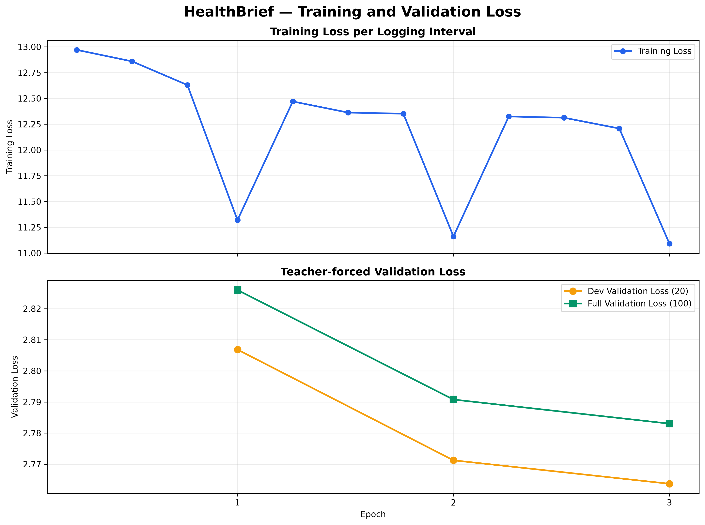
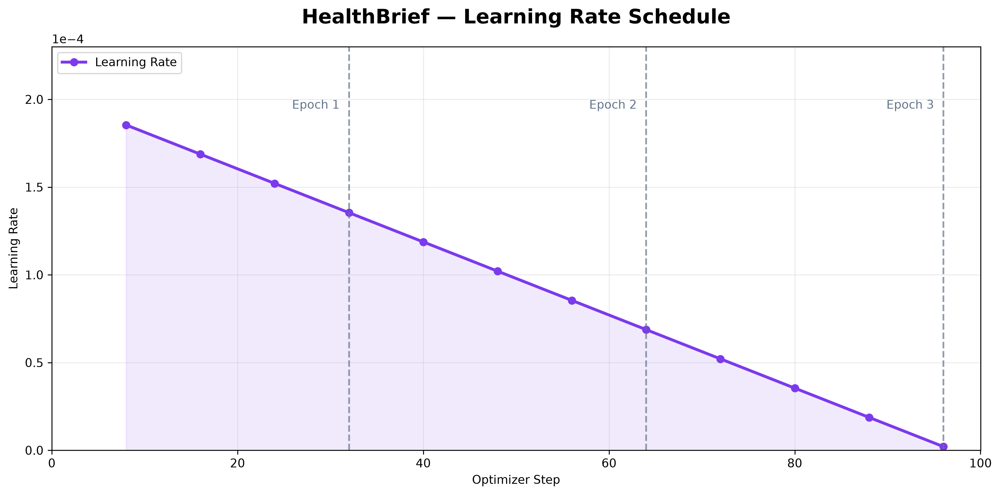
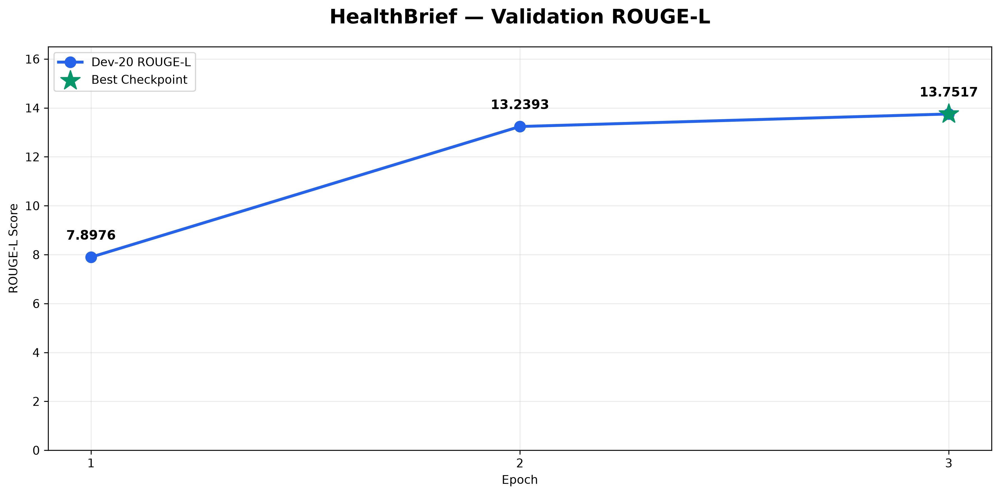

# HealthBrief — Day 03: Controlled LoRA Training and Evaluation

**Date:** 25 November 2026  
**Project:** Week 7 / HealthBrief  
**Notebook:** `notebooks/04_lora_training.ipynb`  
**Base model:** `google/flan-t5-small`  
**Method:** Parameter-Efficient Fine-Tuning (PEFT), LoRA r=8  
**Status:** Training completed; development evaluation completed; formal automated test suite not verified; final holdout not evaluated.

> **Executive finding:** The LoRA adapter improved development-set ROUGE-L from 4.2625 to 13.2745 under matched inference conditions (+9.0120 points). Nevertheless, all five qualitatively inspected LoRA outputs exhibited severe repetition and omitted important findings. Successful optimization and higher lexical-overlap scores did not translate into usable scientific summaries.

## 1. Objective

The objective was to perform a single controlled LoRA fine-tuning run for plain-language biomedical research summarization, measure training and inference behavior, and select a checkpoint using a predefined development metric. The experiment was designed to investigate whether adapting FLAN-T5-small improves summary generation relative to the same base model with its adapter disabled.

The scope included a reproducibility check, a one-micro-batch forward/backward test, three training epochs, generated ROUGE evaluation, teacher-forced loss evaluation, checkpoint verification, resource measurement and a five-article qualitative comparison. Rank, source selection and decoding settings were held fixed within the controlled comparison. No final holdout results are claimed.

## 2. Dataset

Dataset: `BioLaySumm/BioLaySumm2025-eLife` (English biomedical research articles and lay summaries). The previously prepared data were reused without resampling on Day 03.

| Split / subset | Examples | Role |
|---|---:|---|
| Train | 500 | Adapter weight updates |
| Validation | 100 | Teacher-forced loss monitoring |
| Dev-20 (subset of validation) | 20 | Generated ROUGE and checkpoint selection |
| Final holdout | 100 | Reserved for independent final evaluation; not opened during today's work |
| Original official test sample | 100 | Reserved; reference summaries unavailable in the sampled official test |

Dev-20 is not an additional independent split. Its fixed validation indices are:

```text
7, 8, 12, 17, 36, 45, 47, 49, 54, 61, 63, 68, 71, 73, 75, 83, 84, 86, 89, 94
```

These indices were reused from the Monday baseline. Normalized article hashes in the split manifest were checked for overlap between training, validation and final holdout; the reported intersections were empty. The prepared train/validation article IDs matched their manifest sets. Exact normalized hashes do not rule out semantic near-duplicates.

All 600 prepared train/validation examples were retokenized and checked against the saved `input_ids`, `attention_mask` and `labels`; all three columns matched in both splits. The final holdout was checked through the manifest only.

Data provenance: the earlier dataset metadata recorded revision `144e9c785e3a309da804eb6786feb38e6596f390`, seed 42 and streaming buffer-shuffle sampling (buffer size 1,000). The revision was recorded after the initial sampling, so exact historical revision pinning cannot be claimed for that initial download. Dataset license/redistribution permissions have not been confirmed.

## 3. Source Selection

Source Selection V1, prepared on Day 02, was retained. It attempts to find informative sections such as Abstract, Conclusion, Discussion or Results; when headings cannot be matched, it falls back to the opening paragraph and a paragraph selected by research-result cue words. The available token budget is allocated between selected passages, with the prompt and special tokens included in the 512-token encoder limit.

Prompt:

```text
Summarize the following biomedical research article in plain language for a general audience:
```

The earlier ten-article audit used the fallback in all ten cases, retained approximately 492 source-content tokens per article and reported an average source retention of about 3.36%. These audit statistics are not measurements of all 600 records. V1 can truncate sentences and omit critical findings, supporting evidence and context. The five Day 03 sources also contain incomplete boundaries in some cases. The model cannot reliably recover article-specific information that was not supplied in its encoder input.

Target length was set to 768 rather than 256 after the Day 02 target-length analysis. At 768, only 4/500 training targets and 0/100 validation targets were truncated in that analysis; at 256, all 500 training targets and all 100 validation targets were truncated. The revised limit reduces target information loss but increases decoder computation and memory.

## 4. Model Architecture

| Property | Value |
|---|---|
| Architecture | T5ForConditionalGeneration (encoder-decoder) |
| Base model | google/flan-t5-small |
| Encoder layers / decoder layers | 8 / 8 |
| Hidden dimension | 512 |
| Attention heads | 6 |
| Key/value dimension per head | 64 |
| Attention projection dimension | 384 |
| Feed-forward dimension | 1,024 |
| Vocabulary size | 32,128 |
| Base parameters (observed) | 76,961,152 |
| Base weight storage | FP32 |

The loader emitted a tied-weight warning: `shared.weight` and `lm_head.weight` were both present in the checkpoint with different values and were not tied by the installed Transformers loader. The model loaded successfully and the reported parameter count was preserved. No manual weight tying was applied.

A model/tokenizer revision was recorded in `training_environment.csv` during preparation. The last shared model-loading code did not explicitly pass `revision=...`; matching parameter counts do not establish that the exact recorded revision was used in the training run. This remains a reproducibility limitation.

## 5. LoRA Configuration

| Parameter | Value |
|---|---|
| Task type | SEQ_2_SEQ_LM |
| Rank (r) | 8 |
| Alpha | 16 |
| Scaling (alpha / r) | 2 |
| Dropout | 0.05 |
| Target modules | q, v |
| Bias | none |
| Inference mode at initialization | False |
| Adapted projections | 48 |
| LoRA A/B tensors | 48 / 48 |
| LoRA trainable parameters | 344,064 |
| Frozen base parameters | 76,961,152 |
| Total parameters | 77,305,216 |
| Trainable share of adapted model | 0.4451% |

LoRA applies a low-rank update to the frozen weight matrix, `W_eff = W + (alpha/r) * B * A`. For each targeted projection, A has shape `(8, 512)` and B has shape `(384, 8)`. The adapter adds 48 × (4,096 + 3,072) = 344,064 parameters. Total parameter count increases while the number of trainable parameters decreases by approximately 99.55% relative to full fine-tuning.

The original base weights remain available when the adapter is disabled. This does not guarantee that an enabled adapter preserves every prior capability. A direct before/after equality check of all base weights was not performed; only freezing and absence of base gradients during the initial backward test were observed.

## 6. Training Configuration

| Setting | Value |
|---|---|
| Seed / data seed | 42 / 42 |
| Epochs | 3 |
| Initial learning rate | 2e-4 |
| Optimizer | AdamW (`adamw_torch`) |
| Learning-rate schedule | Linear (observed logged schedule) |
| Weight decay | 0.0 |
| Train micro-batch / eval batch | 4 / 4 |
| Gradient accumulation | 4 |
| Nominal effective batch size | 16 (single GPU) |
| Gradient clipping | 1.0 |
| Precision | BF16 mixed precision; FP16 disabled |
| Quantization | None |
| Encoder / target limit | 512 / 768 tokens |
| Generation max length | 768 total decoder positions |
| Generation beams / sampling | 1 / False (greedy) |
| Evaluation / saving | Every epoch |
| Logging | Every 8 optimizer steps |
| Checkpoint retention limit | 3 |
| Evaluation accumulation | 1 |
| Best checkpoint metric | Dev-20 ROUGE-L; higher is better |
| Reload best checkpoint | True |

The nominal 16-example effective batch applies to complete accumulation groups. With 500 examples, there are 125 micro-batches per epoch; the final group contains one micro-batch. Expected optimizer updates: ceil(125/4) × 3 = 96. The observed global step was 96.

A `HealthBriefTrainer` subclass of `Seq2SeqTrainer` ran two evaluations per epoch: generation disabled and loss-only on all 100 validation examples, then generation enabled and ROUGE on Dev-20. The original evaluation settings were restored after the full-loss pass. Final holdout data were excluded.

Environment recorded during preparation: Python 3.14.4, PyTorch 2.14.1+cu130, Transformers 5.14.1, PEFT 0.22.0, Datasets 5.1.0, CUDA 13.0, NVIDIA RTX 4060 Laptop GPU. These are reported notebook values, not independently reproduced in this report. Seed control improves reproducibility but does not guarantee bitwise equality across GPU kernels, library versions or hardware.

### 6.1 Initial forward/backward smoke test

| Metric | Observed value |
|---|---:|
| Micro-batch source shape | (4, 512) |
| Labels / decoder input shape | (4, 625) |
| Forward loss | 3.23531436920166 |
| Peak GPU allocated memory | 3,892.3105 MiB |
| Trainable parameters | 344,064 |
| Nonzero gradient tensors | 48 |
| Frozen parameter tensors with gradients | 0 |
| Optimizer step | Not performed |

This is consistent with standard LoRA initialization: B starts at zero, so A can initially receive zero gradient while B receives a nonzero gradient. The test counted nonzero tensors but did not separately verify all their names. Gradients were cleared and a fresh model/adapter was initialized for the real run.

## 7. Training Results

| Epoch | Global step | Last logged train loss | Dev-20 loss | Full validation-100 loss |
|---:|---:|---:|---:|---:|
| 1 | 32 | 11.319637 | 2.806842 | 2.825991 |
| 2 | 64 | 11.161538 | 2.771235 | 2.790776 |
| 3 | 96 | 11.091480 | 2.763699 | 2.783029 |

All three epochs completed without a reported OOM. The log contained 12 training entries, three full-validation entries, three development entries and one training summary (19 rows at the time of the original extraction). The logged training values in this table are the last interval of each epoch, **not full-epoch averages**.

Training loss shows a downward trend with a regular dip at the end of each epoch. Logged training loss is around four times the evaluation loss. The accumulation factor of four and the incomplete last accumulation group suggest possible loss normalization/logging effects, but the cause was not verified. Raw values have therefore been preserved rather than divided by four. Train/validation loss magnitudes should not be compared directly until that issue is resolved.

Validation loss decreased on both subsets, which is a favorable learning signal, not proof of absent overfitting or of good generation quality. No additional training run or rank comparison was conducted.





## 8. Validation Results

ROUGE scores are reported as F1 on a 0–100 scale using the same decoding and stemming method (`evaluate` ROUGE, `use_stemmer=True`). Token IDs equal to -100 are replaced with the padding ID before decoding; special tokens are skipped. Empty or whitespace-only generations are counted separately but are not dropped from the metric computation.

| Epoch | Dev-20 ROUGE-1 | Dev-20 ROUGE-2 | Dev-20 ROUGE-L | Empty outputs |
|---:|---:|---:|---:|---:|
| 1 | 9.457300 | 1.280576 | 7.897638 | 0 |
| 2 | 14.527154 | 1.691660 | 13.239314 | 0 |
| 3 | 14.778891 | 1.685329 | 13.751730 | 0 |



The largest ROUGE-L improvement occurred between epochs 1 and 2. ROUGE-L continued to increase in epoch 3, while ROUGE-2 declined slightly. The run illustrates that improving teacher-forced loss does not ensure that every generated-text metric improves.

ROUGE-1 measures unigram overlap, ROUGE-2 measures bigram overlap, and ROUGE-L uses a longest common subsequence across the text. ROUGE-Lsum instead uses a summary-level union-LCS calculation with sentence boundaries; correct sentence segmentation is important. ROUGE-Lsum was not used for checkpoint selection.

Teacher forcing conditions the decoder on shifted reference tokens and encoder representations. Free generation conditions on previously generated tokens. This train/inference distinction can lead to accumulated errors (exposure bias), even when training loss falls. Greedy decoding selects the most probable token at each step; beam search retains several candidate sequences but cannot guarantee better ROUGE or factual accuracy. EOS may end generation before the configured limit; neither short nor long output alone establishes summary quality.

## 9. Checkpoint Selection

| Checkpoint | Epoch | Dev-20 ROUGE-L | Selected |
|---|---:|---:|---|
| checkpoint-32 | 1 | 7.897638 | No |
| checkpoint-64 | 2 | 13.239314 | No |
| checkpoint-96 | 3 | 13.751730 | Yes |

Trainer state confirmed `global_step=96`, `epoch=3.0`, `best_metric=13.751729578646366` and `best_model_checkpoint=checkpoint-96`. The predefined ROUGE-L rule was not changed after results were observed. Using validation for checkpoint selection is a normal development practice, but it creates selection dependence: these same 20 examples cannot provide an independent final performance estimate.

Adapter tensor comparison between the in-memory model and `checkpoint-96/adapter_model.safetensors` passed for 96/96 tensors. As the best checkpoint was also the last one, this confirms weight equality but does not independently demonstrate rollback to an earlier checkpoint.

The selected model was saved under `models/healthbrief_best_adapter/`. The subsequent loss-only evaluation on all 100 validation samples returned **2.7830286026000977**, matching the epoch-3 full-validation loss to the reported precision. It was not used to reselect the model.

### 9.1 Saved adapter contents

| File | Bytes | Role |
|---|---:|---|
| adapter_model.safetensors | 1,389,456 | Adapter tensors |
| adapter_config.json | 1,115 | LoRA settings |
| tokenizer.json | 2,424,069 | Tokenizer data |
| tokenizer_config.json | 2,381 | Tokenizer settings |
| README.md | 5,164 | Model information |
| Total | 3,822,185 | Adapter directory contents |

The saved weight file was inspected and contained 96 LoRA tensors, 344,064 parameters and zero non-LoRA tensors. Displayed tensor dtypes were FP32. Raw FP32 adapter tensor storage is 1.3125 MiB; the actual Safetensors file is 1.3251 MiB including format overhead. The theoretical FP32 base-weight size is 293.5835 MiB. The adapter file is roughly 222 times smaller than that theoretical base-weight size. This is a comparison with theoretical weight storage, not a measured base checkpoint file.

The base model is not packaged into this adapter file and must be available when loading it for inference. Generation settings should be reapplied at reload because the displayed saved directory does not contain a standalone generation configuration file.

## 10. GPU Resources

| Metric | Observed value |
|---|---:|
| GPU | NVIDIA RTX 4060 Laptop GPU |
| Total capacity (reported in preparation) | 7.62 GiB |
| End-to-end training call duration | 136.0818445 seconds (~2.27 minutes) |
| Peak allocated memory | 4,620.7739 MiB |
| Peak reserved memory | 7,010.0000 MiB |
| Initial smoke-test peak allocated | 3,892.3105 MiB |
| Expected / observed global steps | 96 / 96 |
| Trainable parameters | 344,064 |
| OOM | Not reported |

Allocated memory represents memory occupied by PyTorch tensors; reserved memory represents memory managed by its caching allocator, including unused cached blocks. Peak reserved does not mean that all reserved bytes were occupied by active tensors. The measured duration and memory cover the training call, including evaluation, checkpoint saving and best-model loading, not pure training alone. Other live GPU allocations or runtime behavior may affect these measurements.

LoRA reduces gradient and optimizer state storage for frozen weights but still requires the base weights, activations, attention computation and logits. Gradient accumulation reduces concurrent activation memory without removing forward/backward computation. Increasing decoder length from 256 to 768 increases decoder activations, cross-attention and logits; conventional decoder self-attention has quadratic sequence-length computation, although actual memory and total runtime do not necessarily increase ninefold. Dynamic padding, evaluation generation, optimizer operations and allocator behavior cause GPU memory usage to vary during the run.

## 11. Baseline Comparison

### 11.1 Historical Monday baseline (not controlled against today's run)

| Model | ROUGE-1 | ROUGE-2 | ROUGE-L |
|---|---:|---:|---:|
| Lead-3 | 17.61 | 4.72 | 10.52 |
| Zero-shot FLAN-T5-small | 4.33 | 1.14 | 3.47 |

Monday used the first 512 encoder tokens and a different generation limit (512 new tokens). Today's V1 source selection and 768 total decoder positions differ, so a comparison with Monday cannot isolate LoRA's contribution.

### 11.2 Matched Dev-20 comparison

The same 20 examples, tokenized source inputs, decoded reference labels, tokenizer, greedy decoding settings and BF16 autocast were reused. The same model object was evaluated first with the adapter disabled (`disable_adapter()`), then with the adapter enabled. Base-weight equality before and after training was not exhaustively checked; the comparison uses the frozen-base training design.

| Metric | Zero-shot (adapter off) | LoRA (adapter on) | Difference (LoRA − zero-shot) |
|---|---:|---:|---:|
| ROUGE-1 | 5.163355 | 14.197240 | +9.033885 |
| ROUGE-2 | 1.379274 | 1.478052 | +0.098778 |
| ROUGE-L | 4.262540 | 13.274526 | +9.011986 |
| Mean generated content tokens | 61.55 | 752.40 | +690.85 |
| Empty outputs | 0 | 0 | 0 |
| Inference time, 20 examples (s) | 5.050054 | 25.785771 | +20.735717 |

The adapted model generated about 12.22 times as many content tokens and took about 5.11 times as long in this single timed run. Content lengths exclude special tokens. Timing includes data transfer and generation but excludes ROUGE computation; the fixed run order and GPU caching were not controlled by repeated timing trials. The duration difference cannot be attributed to adapter overhead alone.

The manual inference ROUGE-L (13.274526) differed from the Trainer evaluation score (13.751730) by approximately -0.477204 points. The exact reason was not investigated; generation implementation/precision differences and ROUGE aggregation variability are possible contributors. The two evaluations are reported separately and the original checkpoint selection is retained.

These results are development-set comparisons, not independent test performance.

## 12. Error Analysis

Five deterministic positions from Dev-20 (0, 4, 9, 14, 19) were chosen for qualitative review, corresponding to validation indices 7, 36, 61, 75 and 94. The selected source text, reference summary and both actual generations were reviewed. Annotations concern evidence in the model-visible source, not necessarily the complete article. The judgments are preliminary manual labels; no independent expert adjudication was conducted.

| Validation index | Research topic | Zero-shot tokens | LoRA tokens | Main observed issue |
|---:|---|---:|---:|---|
| 7 | FLC epigenetic memory | 18 | 767 | Zero-shot mentions functional fusion proteins but misses cis memory; LoRA loops over molecular phrases. |
| 36 | Postmortem microbial communities | 23 | 767 | Zero-shot misrepresents study organisms; LoRA captures the PMI topic but repeats one sentence and misses quantitative results. |
| 61 | Calcium imaging and neural activity | 17 | 767 | Both miss detection limits; LoRA introduces an unsupported relationship with development of neural dynamics and repeats it. |
| 75 | Chromosome restructuring / genome elimination | 767 | 767 | Both models enter repetitive loops and omit chromosome shattering, repair and inheritance findings. |
| 94 | Monoallelic gene expression | 26 | 767 | Zero-shot broadly identifies the MAE detection purpose; LoRA confuses expression/signature detection with autosomal gene synthesis. |
| Mean (five reviewed examples) | | 170.2 | 767.0 | Not representative of all validation examples. |

### 12.1 Manual error annotations

Counts are per output with at least one identified instance in the category. Categories are not mutually exclusive. `Unclear` is separate from `No`; zero confirmed errors does not prove an absence of error.

| Error category | Zero-shot Yes | Zero-shot Unclear | LoRA Yes | LoRA Unclear |
|---|---:|---:|---:|---:|
| Unsupported claim | 1 | 1 | 2 | 2 |
| Contradiction | 1 | 1 | 0 | 2 |
| Important omission | 5 | 0 | 5 | 0 |
| Terminology error | 1 | 0 | 3 | 0 |
| Uncertainty error | 0 | 1 | 0 | 2 |
| Incomplete summary | 5 | 0 | 5 | 0 |
| Severe repetition | 1 | 0 | 5 | 0 |

All five adapted outputs exhibited severe repetition; one of five base outputs did. All five adapted outputs contained 767 content tokens, consistent with reaching the 768-position decoder limit including its start token. Their truncated-looking endings and lengths strongly suggest failed EOS termination, but raw EOS positions were not separately recorded. The exact fraction of affected outputs across Dev-20 was not measured.

The source-visible evidence shows that the adapted model often repeats topic-related phrases rather than conveying more useful findings. Higher ROUGE can coexist with repetition, unsupported scientific relationships and omissions. Longer outputs can increase overlap recall, but ROUGE F1 also penalizes unmatched content through precision; length is not a guaranteed route to higher scores.

Potential causes include greedy decoding, exposure bias, inadequate EOS learning, limited training data/model capacity and mismatched source/target information. These remain hypotheses; no causal ablation was conducted. It is plausible that reference summaries contain information absent from the selected source, but this experiment did not directly establish that such information caused particular hallucinations.

## 13. Limitations

- **Small and reused development subset:** Dev-20 is used for checkpoint selection and matched comparison, so reported improvements may not generalize. The 100-example loss is also a development metric, not an independent test.
- **Source coverage:** V1 fallback and 512 encoder tokens can omit essential results. Reference summaries can contain information outside the model-visible source. Article-level faithfulness and input-grounded faithfulness are distinct.
- **Metric validity:** ROUGE measures lexical overlap, not scientific accuracy, semantic coverage, readability, uncertainty preservation or repetition-free generation. Empty-output count does not detect nonempty degenerate outputs. Selecting by ROUGE-L alone may favor an unusable model.
- **Repetition and termination:** Five reviewed LoRA summaries were severely repetitive and reached the apparent length cap. EOS positions and corpus-wide repetition were not systematically quantified.
- **Training scope:** Only one run, one seed, one rank and 96 global steps were observed. No statistical uncertainty estimates or causal attribution across configuration choices are available.
- **Loss logging:** The approximately fourfold training/evaluation loss discrepancy remains unresolved. Last-interval training loss is not an epoch average.
- **Reproducibility:** The final shared model loading code was not revision-pinned; GPU determinism was not guaranteed. The two generation evaluation implementations produced different ROUGE-L values for the selected adapter.
- **Weight integrity:** Initial frozen-gradient checks and adapter equality passed. Exact base weight equality before versus after the complete training run was not established.
- **Qualitative labels:** Five examples, manually judged against truncated source inputs, are insufficient for a comprehensive factuality estimate. Some claims were unclear, not proven correct or incorrect.
- **Resource timing and licensing:** Inference timing used one run per configuration; dataset redistribution permission remains unconfirmed.
- **Final holdout:** No independent final evaluation or deployment-readiness claim is made.

## 14. Tests

Eight automated test categories were specified in the Day 03 plan. The table distinguishes actual notebook evidence from an independently executed automated test suite. No pytest output for these eight tests was supplied; therefore **a formal 8/8 pass is not claimed**.

| # | Test | Intended check | Observed notebook evidence | Formal status |
|---:|---|---|---|---|
| 1 | Dataset Integrity | 500 train, 100 validation, valid token lengths and aligned inputs/labels | Counts, length assertions and full 600-example tokenizer consistency reported PASS. | Suite not run/verified |
| 2 | Holdout Isolation | No train/validation/holdout article-ID overlap; holdout unused | Manifest intersections reported empty; holdout not opened in the documented workflow. | Suite not run/verified |
| 3 | Trainable Parameters | Exactly 344,064 trainable parameters; expected adapter configuration | Parameter-count assertion passed; 0.4451% trainable share observed. | Suite not run/verified |
| 4 | Frozen Parameters | Base gradients absent; base weights unchanged across training | Zero frozen gradient tensors in smoke test; full before/after base-weight equality not performed. | Partial notebook evidence; suite not verified |
| 5 | Training Steps | Expected 96 global steps and three completed epochs | Trainer state confirmed 96 steps and epoch 3.0. | Suite not run/verified |
| 6 | Metric Validity | Finite ROUGE in [0,100], valid loss/counts, empty generations included | Reported scores in range; no empty outputs in the measured runs; no explicit comprehensive metric-validity test output supplied. | Partial notebook evidence; suite not verified |
| 7 | Checkpoint Validity | Selected checkpoint matches max Dev-20 ROUGE-L; loaded adapter matches saved weights | checkpoint-96 selected; 96/96 exact tensor comparisons passed. | Suite not run/verified |
| 8 | Adapter Validity | Saved adapter contains expected keys, 96 tensors, 344,064 parameters, no base tensors | File content assertions passed; independent fresh reload/inference not demonstrated. | Suite not run/verified |

Test execution evidence must be recorded separately when the automated suite is run. In particular, neither absence of initial gradients nor successful adapter saving substitutes for a full post-training frozen-weight check or a fresh adapter reload test. The previous Monday empty-output case (sample 54) was not observed as an empty generation in the current matched Dev-20 run, but this does not establish a general absence of generation failures.

## 15. Conclusion

The Day 03 run successfully trained 344,064 LoRA parameters in three epochs with 96 global optimizer steps on a single RTX 4060 Laptop GPU. The selected checkpoint, checkpoint-96, had Dev-20 ROUGE-L 13.751730 and reproduced the full validation-100 teacher-forced loss of 2.783029. All 96 selected adapter tensors matched the checkpoint, and the exported adapter file contained only the intended low-rank weights.

Under matched development inference conditions, the adapted model improved all three ROUGE scores relative to the adapter-disabled baseline. However, it generated far longer texts and all five qualitatively reviewed outputs showed severe repetitive degeneration. The central conclusion is that **technical training success and metric improvement are not evidence of usable biomedical summarization**. In particular, a model can improve teacher-forced loss and ROUGE while failing to communicate key research results faithfully and concisely.

The selected adapter is retained as the result of the predefined experiment, not as a deployment-ready model. The next planned evaluation should assess scientific grounding, content coverage, repetition and termination more comprehensively, without changing today's recorded experiment or using the final holdout prematurely.

### Repository outputs

| Path (relative to HealthBrief) | Purpose |
|---|---|
| `notebooks/04_lora_training.ipynb` | Training, evaluation and notebook checks |
| `reports/training_environment.csv` | Recorded environment and revisions |
| `reports/training_history.csv` | Epoch-level training and development metrics |
| `reports/training_resource_usage.csv` | GPU, runtime and training resource metrics |
| `reports/lora_baseline_comparison.csv` | Matched Dev-20 quantitative comparison |
| `reports/qualitative_summary_comparison.csv` | Five-article, two-model qualitative analysis |
| `figures/training_validation_loss.png` | Raw logged loss curves |
| `figures/validation_rouge_l.png` | Checkpoint selection curve |
| `figures/learning_rate_schedule.png` | Logged learning-rate schedule |
| `models/healthbrief_best_adapter/` | Selected adapter and tokenizer |
| `reports/day_03_lora_training.md` | This technical report |

The report uses the notebook outputs and supplied qualitative text from Day 03, plus the previously documented dataset and model preparation. It does not independently inspect the local repository. The requested CSV paths and figure references should be checked in the repository before committing; the final qualitative CSV save and the two training CSV saves were instructed but their file existence was not independently verified here. Do not publish raw dataset text, model artifacts or checkpoints before checking their licenses and the repository's intended artifact policy.
